# PopAgent

[](https://github.com/duzhenxun/pop-agent/releases)
[](https://www.npmjs.com/package/pop-agent)
[](https://github.com/duzhenxun/pop-agent/stargazers)
[](https://nodejs.org)
[](LICENSE)
[](https://pop.xs25.cn/)

[中文](README.zh.md) · **English** · [Website](https://pop.xs25.cn/) · [Gitee mirror](https://gitee.com/duzhenxun/pop-agent)

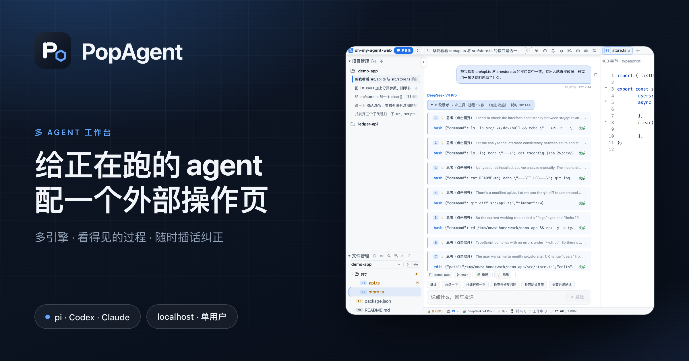

One line: **an external control surface for the agent you're already running.** The engine keeps running on your own machine; the web page is where you watch it work, manage its tools and models, cut in to correct it whenever you like, and — when the moment comes — read files, open a terminal, or highlight a passage and ask for a change.

Single user, loopback only, and **the engine's own on-disk files are always the source of truth for a conversation** — no database, no account system, no second copy of the session in our own store. One `pop-agent` process is one person's workbench.

Beyond "watch it work", there are six things most other agent front-ends never bother with: **it can listen and speak, run itself every morning, drive your Mac, draw the plan, push to your phone, and be reached from outside** — see [Six things most front-ends skip](#six-things-most-front-ends-skip).

---

## Install

### macOS: download the app (easiest — no Node required)

Grab `PopAgent-<version>-arm64.dmg` (Apple Silicon) from [Releases](https://github.com/duzhenxun/pop-agent/releases/latest) and drag it into `/Applications` — **no Node, no terminal**. The runtime ships inside the app; double-click and you have the whole workbench.

> Intel Macs: use the npm route below for now (or run the arm64 build under Rosetta).

The first launch may be blocked. Two different messages, two different fixes (these builds carry only an ad-hoc signature added at packaging time — no Apple Developer identity):

- **"Cannot be opened because the developer cannot be verified"** → `Right-click → Open` once. On macOS 15 and later you can also allow it under System Settings → Privacy & Security → "Open Anyway".
- **"is damaged and can't be opened. You should move it to the Trash"** → **don't delete it.** That is not a corrupt download; the signature no longer matches the bundle. Run these two lines:

  ```bash
  codesign --force --deep --sign - /Applications/PopAgent.app
  xattr -dr com.apple.quarantine /Applications/PopAgent.app
  ```

### Other platforms, or you prefer the CLI: install globally with npm (recommended)

Requires **Node.js ≥ 22.19** and **npm ≥ 9**; macOS / Linux / Windows all work. You end up with a `pop-agent` command (short aliases: `pop`, `pop-agent` — all equivalent).

```bash
npm -g install pop-agent
```

No version tag means the current release. To pin a version or use a mirror:

```bash
npm -g install pop-agent@latest
npm -g install pop-agent@<version> --registry=https://registry.npmmirror.com
```

You get three commands that all point at the same entry point: **`pop-agent`** (used throughout this README),
`pop` (the short alias you'll probably type), and `pop-agent`.

Upgrade and uninstall:

```bash
pop-agent upgrade               # same as npm -g install pop-agent@latest
npm -g uninstall pop-agent      # uninstall; data in ~/.pop-agent is left alone
```

On Linux, `node-pty` (the embedded terminal) ships prebuilds only for macOS / Windows, so Linux compiles it in place: you need `make`, `g++` and `python3`. When those are missing, both the page and the install script say exactly what's missing — the terminal won't open until then.

> **`allow-scripts` notices from npm 11.16+**: newer npm lists every dependency install script you haven't approved yet (`npm warn allow-scripts ...`). This package **ships no install scripts of its own** (the old one only pruned `node-pty` prebuilds for other platforms; that now happens lazily on startup), so anything listed is a transitive dependency such as `node-pty` (native build), `protobufjs`, or `@google/genai`. It is only a notice — the install still completes. To silence it after a review: `npm approve-scripts node-pty protobufjs @google/genai` (or `npm approve-scripts --all`).

### One-line install (never touches global npm)

macOS / Linux:

```bash
curl -fsSL https://raw.githubusercontent.com/duzhenxun/pop-agent/main/scripts/install.sh | sh
```

Windows (PowerShell):

```powershell
powershell -c "irm https://raw.githubusercontent.com/duzhenxun/pop-agent/main/scripts/install.ps1 | iex"
```

The script does four things: **finds a new enough Node** (downloads an official build into `~/.pop-agent/node` and checks its sha256 if needed), **`npm install -g --prefix ~/.pop-agent`** (never the system-wide prefix, no sudo), **links `pop` / `pop-agent` / `pop-agent` into `~/.local/bin`** (patching PATH if necessary), and **smoke-tests once** (version string + whether `node-pty` can be required, i.e. whether the terminal will open).

That `~/.pop-agent` is also the **data directory**: what gets installed (`node/`, `lib/`, `bin/`) sits next to your `settings.json`, `password`, `uploads/` and `logs/`.

| What you want to change | How (`sh` version; PowerShell uses env vars) |
|---|---|
| Version | `POP_AGENT_VERSION=<version>` (or `--version <version>`) |
| Install elsewhere | `POP_AGENT_HOME=/opt/pop-agent` (or `--home /opt/pop-agent`) |
| Registry mirror | `POP_AGENT_REGISTRY=https://registry.npmmirror.com` (or `--registry …`) |
| Leave PATH alone | `POP_AGENT_NO_PATH=1` (or `--no-modify-path`) |
| Install build tools | `POP_AGENT_BUILD_TOOLS=1` (or `--with-build-tools`) |
| Uninstall | `… \| sh -s -- --uninstall` (removes only what was installed; `settings.json` / password / uploads / logs stay) |

---

## Commands

The three commands are completely equivalent; everything below is written as `pop-agent` (`pop` is its short alias).

| Command | What it does |
|---|---|
| `pop-agent` | **Start (default)**: runs in the foreground and opens the browser, logs right in the terminal, `Ctrl-C` to quit; default workspace = current directory |
| `pop-agent start -d` | Run in the background (detached, logs go to `daemon.log`), handing the terminal straight back |
| `pop-agent status` | pid / port / uptime / engine / session count / workspace |
| `pop-agent restart` | Stop then start (foreground by default; `-d` for background) |
| `pop-agent stop` | Stop the running instance (foreground or background — it reads the lock file in the data dir instead of guessing a port) |
| `pop-agent version` | Version string (`-v` / `--version` are synonyms) |
| `pop-agent upgrade` | Upgrade to the latest release (it runs `npm -g install pop-agent@latest`) |
| `pop-agent help` | Show help (`-h` / `--help` are synonyms) |

Two behavioural rules:

- **Starting twice is detected first**: if an instance is already running it only prints the URL (and opens the page) instead of starting a second one — identical for `pop` / `pop-agent` / `pop-agent`.
- **The foreground run stays quiet**: the terminal only gets one `已启动：…` line plus warn / error; normal logs (session index loading, SSE connections) still go in full to `logs/pop-agent.log`. Watch them with `POP_AGENT_LOG=info pop`; in the background (`-d`) they land in `daemon.log`.
- **It asks whether to upgrade**: on start (and on `pop status`) it asks npm once per six hours (cached in `update-check.json`) and, when a newer release exists, asks `现在升级吗？[Y/n]` — **plain Enter upgrades** and restarts into the new version (`pop-agent -d` asks before detaching too); `n` skips and asks again next start. Non-interactive runs (CI / `pop > log`) never prompt, they just print `有新版本 vX（当前 vY）→ 升级：pop upgrade`. `POP_AGENT_UPDATE_PROMPT=off` drops only the prompt, `POP_AGENT_UPDATE_CHECK=off` turns the check off entirely.

### Flags

| Flag | Env var | Default | Notes |
|---|---|---|---|
| `-p, --port` | `POP_AGENT_PORT` | `9090` | Listen port |
| `-H, --host` | `POP_AGENT_HOST` | `127.0.0.1` | Listen address; only change it for remote access |
| `-P, --password` | `POP_AGENT_PASSWORD` | none | Login password; unset = loopback only (remote cannot enter). A value given here is saved into `<dataDir>/password`, **and that file is the single source of truth afterwards** (the env var is only used when the file does not exist yet); Settings → Remote edits the same file |
| `-d, --detach` | — | off (foreground by default) | Background run, detached, logs go to `~/.pop-agent/daemon.log`; `-f` / `--foreground` is the old spelling and now equals the default |
| `--no-open` | — | on | Don't open the browser |
| `--allow-host` | `POP_AGENT_ALLOWED_HOSTS` | none | Rarely needed: extra cross-origin hosts for requests **addressed to this machine** only |
| `--data-dir` | `POP_AGENT_DATA_DIR` | `~/.pop-agent` | Settings, password, uploads, logs and the lock file live here |
| — | `POP_AGENT_CWD` | `process.cwd()` | Default workspace (before any session exists) |
| — | `POP_AGENT_ENGINE` | `pi` | Default engine |
| — | `POP_AGENT_APPROVAL_MODE` | `allow` | Default approval mode for new sessions; `ask` confirms every tool call |
| — | `POP_AGENT_TURN_TIMEOUT_MS` | 20 minutes | Per-turn watchdog timeout |
| — | `POP_AGENT_LOG` | `info` (foreground terminal: warn / error only) | `debug` / `info` / `warn` / `error`; setting it explicitly also prints that level to the terminal |
| — | `POP_AGENT_UPDATE_PROMPT` | `on` | Whether to ask `现在升级吗？` in the terminal when a newer release exists (Enter = upgrade); `off` keeps only the passive notice line |
| — | `POP_AGENT_UPDATE_CHECK` | `on` | `off` disables the startup release check (offline / intranet / CI) |

### Common examples

```bash
pop-agent                                    # foreground + open the page (the usual one, Ctrl-C to quit)
pop-agent -d                                 # background, terminal handed straight back
pop-agent -p 9191                           # different port (when 9090 is taken)
pop-agent status && pop-agent restart  # check, then restart
pop-agent stop                               # stop it (works for foreground and background)
pop-agent --data-dir ~/pop-agent-data             # different data directory
POP_AGENT_CWD=~/code/my-proj pop-agent       # set the default workspace
pop-agent -H 0.0.0.0                           # reachable outside (set the password locally first)
pop-agent -H 0.0.0.0 -P 'my-pass'             # start with a password — saved, so restarts keep it
```

> **Reaching it from your phone**: `pop-agent -H 0.0.0.0`. Set the password **on the machine running it first**: open `http://127.0.0.1:9090/` and use the field in **Settings → Remote** (or open `/setup`, or start with `-P`).
> The password lives in the data directory's `password` file (default `~/.pop-agent/password`) — no environment variable needed. Afterwards **a LAN IP, a public IP or a domain** all work by entering that password; **no `--allow-host` allowlist** is required.
> It can only be set locally: while unset, remote visitors just see "set it on the host machine" (`/setup`, `/api/auth/setup` and `/api/auth/password` return 403 for remote). Otherwise whoever scanned the port first would take over. Reverse proxies / tunnels should pass `X-Forwarded-For` (origin checking looks at it).
> **Login protection**: after **3** wrong passwords from the same source, sign-in is paused for **30 minutes** (the password is not even compared while locked). Change both numbers in **Settings → Remote** (1–20 tries, 1–1440 minutes); the policy and any live locks are stored in `<data dir>/login-guard.json`, so a restart does not unlock anyone. Settings → Remote also lists recent **login activity** (source IP, success, which wrong try, lockouts — newest first), kept in `<data dir>/login-activity.json` (last 200 events).
>
> **Running `pop-agent` from your home directory** works, but home is an unsafe workspace (the file tree, search and the agent's cwd would be your whole home). In that case it falls back to `<data dir>/workspace` and prints a line about it; to point at a project use `POP_AGENT_CWD=/path/to/project`.

Each engine also has its own escape hatches (all have defaults; you normally don't touch them): `POP_AGENT_CODEX_BIN` / `_HOME`, `POP_AGENT_DSH_BIN` / `_HOME` / `_MODEL` / `_PATCH`, `POP_AGENT_OPENCODE_BIN` / `_ARGS` / `_MODEL`, `POP_AGENT_CLAUDE_BIN` / `_ARGS` / `_MODEL` (it auto-detects `claude-code-acp` / `claude-agent-acp` and says so when neither is installed).

---

## What it is, what it isn't

**It is**: a front end that spreads the agent's *process* out in front of you. Thinking blocks, tool calls, changed files, tokens and cost all live in the conversation stream. You can cut in mid-turn, highlight a passage to file a comment on it, or open a scratch chat that never touches disk just to ask one question.

**It is not**: a new agent engine, and it is not a SaaS that moves your sessions into the cloud. It does not rewrite prompts and does not take over tool implementations — what you install is pi / Codex / Claude Code / opencode / DeepSeek Harness, and the workbench just gives them a readable UI, clickable buttons, and a session list that survives restarts.

Three hard rules:

1. **No database**: a conversation *is* the JSONL / thread the engine wrote. The web UI reads it, renames it, and deletes it when asked.
2. **No pretending**: anything an engine can't do is hidden in the UI (the capability matrix); a panel that can't get data says so, and no other engine's config is passed off as this one's.
3. **No overreach**: it listens on `127.0.0.1` only by default; exposing it remotely takes `-H` plus a password set locally (**Settings → Remote**, or `-P`).

---

## Six things most front-ends skip

Most agent UIs stop at "chat". These six are finished and used daily — and they are where most of the work went.

### 1. Live voice: speak and it types along; it answers and reads it back

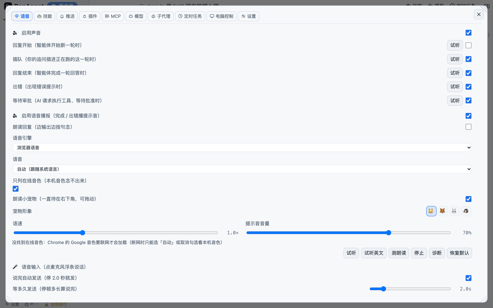

- **Talk instead of typing**: the mic bubble in the composer listens as you speak and **text lands in the box word by word** — not one blob at the end. "Send automatically when I stop talking" is a setting; you can also hold the key, say one short thing, and release.
- **One key, two behaviours**: tap to keep listening (tap again to stop), hold to talk and release to send. The bubble drags anywhere on screen.
- **It reads its answer out loud**: TTS for the final reply with adjustable speed and voice, plus pause / resume / stop (buttons on the floating bar and shortcuts). Four event types (start / end / error / waiting for approval) each have their own cue, previewable, with its own volume.
- **Offline by default**: speech-to-text prefers macOS local recognition (`SFSpeechRecognizer`) and text-to-speech uses the system voice — nothing leaves the machine, no network, no cost. Switch to `edge` (Microsoft) or your own `kokoro` / `qwen3` for one consistent voice.

### 2. Scheduled tasks: say it once, it runs every morning

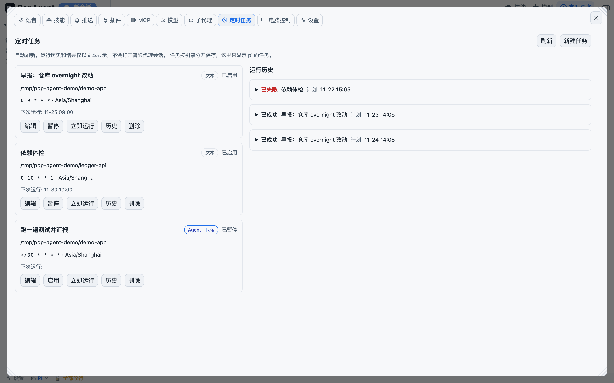

- **A task = a prompt + a five-field cron expression + a timezone.** Pick "every N minutes / daily / weekdays / weekly / monthly" in the panel, or type `0 9 * * *`.
- **Two kinds**: `text tasks` go straight to the model with no tools and no repo access (cheapest); `agent tasks` run a real turn in the workspace and can read files, run commands and edit code.
- **Create them from the chat**: on pi the agent has a `cron` tool, so "check this repo's changes every morning at 9" gets its name, workspace and timezone filled in for you.
- **Unattended means unattended**: nobody clicks an approval dialog at 3am, so **writes are denied by default** unless you tick "allow file changes" on that task; a task that hits the watchdog limit is interrupted and recorded as **failed** — half an answer is never reported as success.

### 3. Computer control: the agent actually drives your Mac

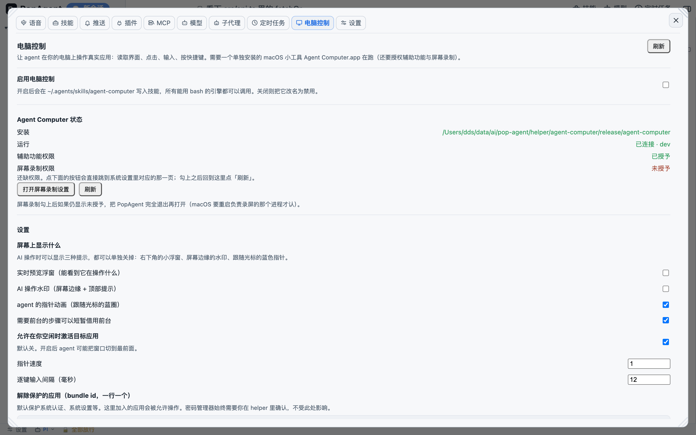

Not the "screenshot and guess the coordinates" approach: it reads the **macOS accessibility (AX) element tree** and clicks by element id, so clicks land and the meaning is known.

- **What it can do**: click by id (`AXPress`, falling back to coordinates only when needed), type / set values / paste (long text goes through the clipboard and the previous clipboard is restored), send shortcuts, scroll, drag in steps, run menu paths, and wait for the UI to settle between steps.
- **What it refuses**: password fields are never filled in for you; system authentication and apps protected by System Settings stay off-limits unless you list them as exceptions.
- **The master switch is the skill itself**: turning it on writes the `agent-computer` skill to disk, so **any engine with bash** can drive the Mac — not just pi. Turning it off disables the skill and deletes nothing.
- It needs a local helper (*Agent Computer.app*); the panel shows where it is, whether it runs, and whether Accessibility and Screen Recording are **actually granted**.

### 4. Canvas: draw "what happens next" as a graph

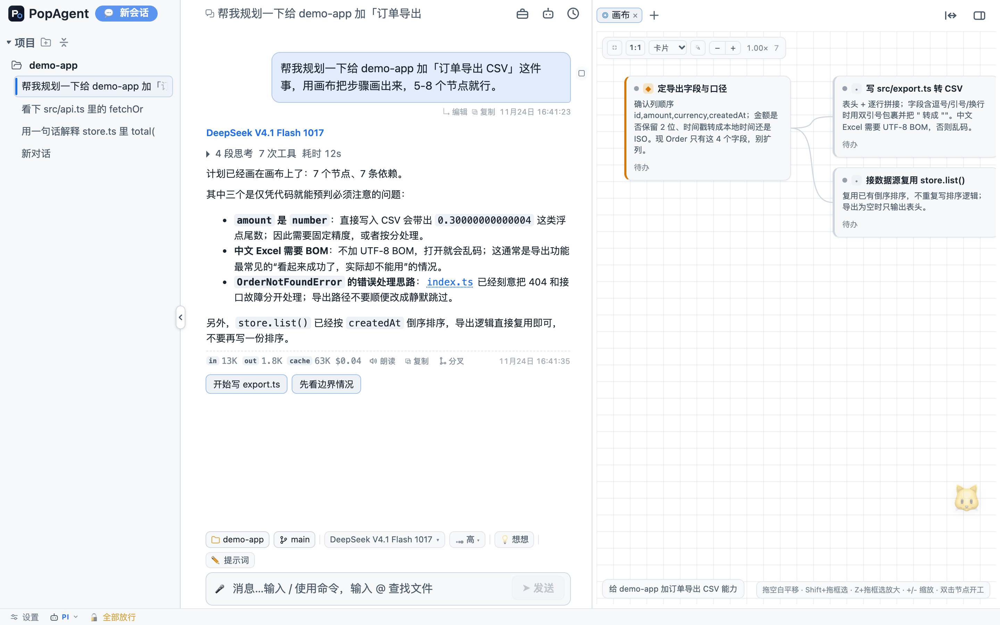

- Describe something that takes many steps and the agent calls the `canvas` tool to lay it out as **nodes plus dependency edges** on the right. Nodes carry kinds (task / milestone / risk / decision / doc), so it is obvious which step is likely to blow up and which one needs your decision.
- **It is interactive**: mark a step running when you start it and done when you finish — progress shows up on the canvas, not just in chat.
- **It drills down**: when one step hides several sub-steps, use a sub-plan and keep the main graph to summaries.
- Layout is computed by the host from the dependency graph, so the model never worries about coordinates.

### 5. Push to your phone: the phone buzzes when a turn ends

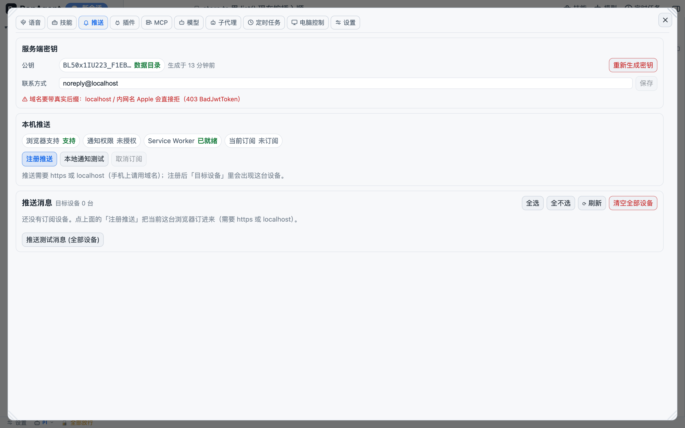

- **One push per finished turn**: the title is the project, the body is the session; failures get ❌ and interruptions ⏹.
- **Web Push (VAPID)**: no third-party service. Keys are generated on first start (`vapid-keys.json`, mode 0600). Multiple devices, test push, clear all.
- Add it to your phone's home screen and it behaves like an app (PWA); tapping the notification opens that session.

### 6. Remote access: keep working from your phone, elsewhere

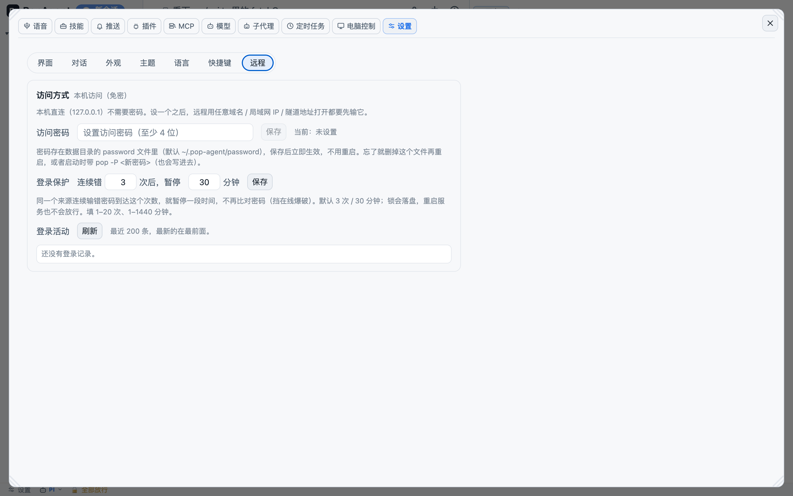

- `pop-agent -H 0.0.0.0` and you can open it from a phone or another computer. **The password must be set on the machine itself** (remote clients may not set one — otherwise whoever finds the port first takes over).
- **Login protection**: three wrong passwords from the same origin pauses it for 30 minutes (both tunable), and while paused the password is not even compared; restarting the service does not unlock it. The panel also lists recent login activity (which IP, success / which attempt failed / paused).
- **The phone really gets a phone layout**: the sidebar becomes a drawer, the top bar keeps icons only, the composer goes to 18px so iOS does not zoom, and the right pane becomes a full-screen second page.

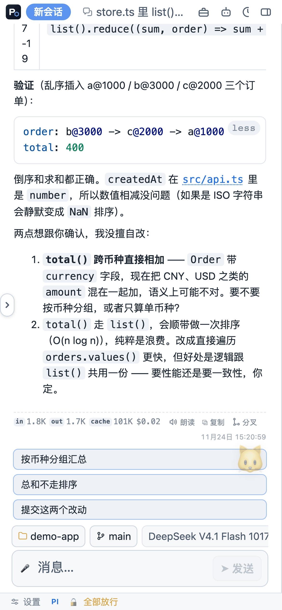

> Voice, scheduling, computer control, canvas, push and remote all live in **one process**, not bolted-on tools — so they share the same sessions, the same workspace and the same approval rules.

---

## Conversation

**Streaming text + collapsible thinking blocks + tool cards.** A tool card shows arguments, the full command (copyable), output, duration and pass/fail. While the turn runs, thinking and tool calls **show only the one line of narration from the newest group** (no thinking rows, no tool cards — the command that is actually running is reported by the status line at the very bottom; the "N thinking · N tools · Xs" stopwatch sits on top), then **fold into that row when the turn ends** (everything before the final conclusion) — click it to get the full timeline back, so only the final answer stays on screen.

The footer of every reply is the usage **for that turn**: input (cache miss) / output / cache read / cost, with a "Copy" that takes the whole block. The running total for the session is behind the context ring in the status bar (subagents are separate sessions billed separately and are not counted there).

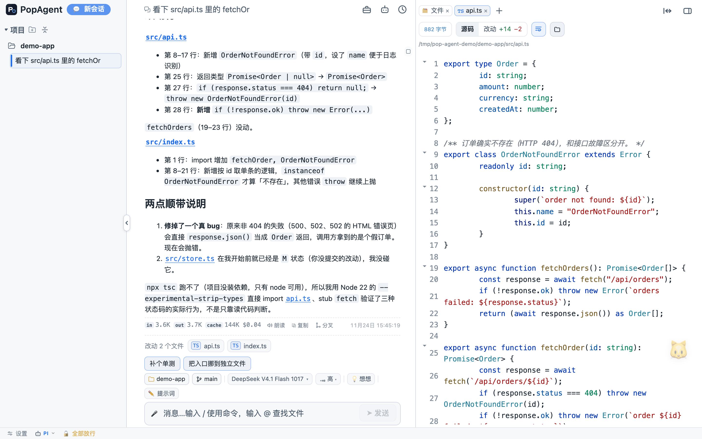

A few things in the conversation are clickable:

- **Changed-files chip**: which files this reply touched (a chip at the bottom of the reply, e.g. `1 file changed / store.ts`); one click lands you straight on the diff in the right pane.
- **Branch icon**: "Branch from here", which starts a new conversation at this message; the original stays byte-for-byte unchanged.
- **File paths**: a path like `web/src/App.tsx` in the body opens in the preview.

### Cutting in, queueing, stopping

While a turn is running, the composer does not lock up:

| Action | Meaning |
|---|---|
| **Steer** | Takes effect immediately, inserted into the current turn as the next instruction |
| **Queue** | Wait until this turn ends; you can see what's at the head of the queue and retract anything |
| **Stop** | Interrupt the turn and keep whatever was already produced |

Steering comes in two flavours, and the UI says which one you get:

- **pi: a real steer.** Its SDK has `streamingBehavior: "steer"`, so the message joins **the same turn** (the model sees it on its next sampling step). The turn does not end and the transcript has no seam.
- **codex / opencode / DeepSeek Harness / Claude Code: interrupt and continue.** Their local protocols (JSON-RPC / ACP) allow exactly one prompt per session at a time and have no notion of steering, so the host first **stops the current step** and then sends your message as **the next turn**. The button says "interrupt the current step", the transcript keeps a seam where the turn was cut, and a tool that was running is marked `interrupted`.

Both paths obey one rule: **never fire a second message that would flush the engine's own active turn** (that leaves the session permanently busy). If the turn does not stop within 5 seconds, the steer degrades to queueing with a visible notice.

---

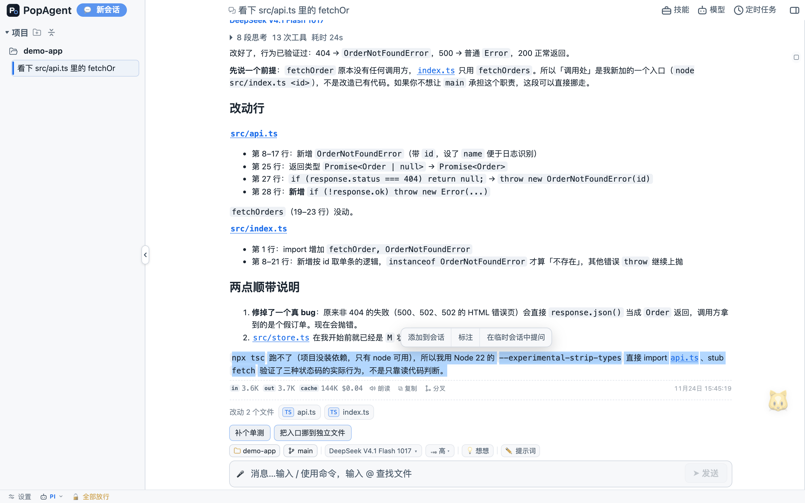

## Notes: highlight a passage and comment on it

**Select some text in the conversation** and a small toolbar floats up: `Add to session` / `Annotate` / `Ask in a temp session`.

"Annotate" attaches a comment to that text. The body keeps a **①②③ numbered badge**, and an "N notes" pill appears in the composer — open it to read, edit or delete each comment, or `Quote it`.

On send it is assembled into a block like this (you can also hit `Quote it` yourself, in which case only your own words go out):

```
Note 1:
> The panel starts at y=0, but the top bar's z-index is 45

This needs to be one sentence shorter
```

Notes are **local anchors**: they locate themselves by "quoted text + surrounding context", so badges still find their place after the body reflows or a stream appends more text. They live in this browser's `localStorage`, isolated per session — never on the server, never in the cloud, invisible from another device.

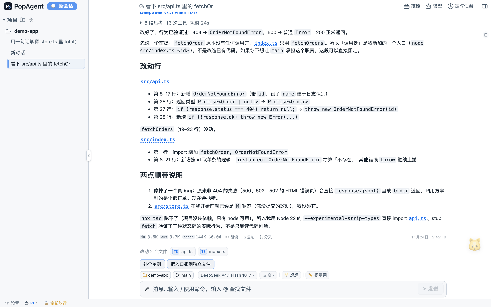

**Line references in files** are the other road: select lines in the preview (`Shift+click` for a range, `Ctrl/Cmd+click` to add, right-click for the line menu) and "Add to conversation" writes a **path plus line numbers** such as `@web/src/App.tsx:120-138`, leaving the agent to read it.

---

## Side chat: ask one question and go

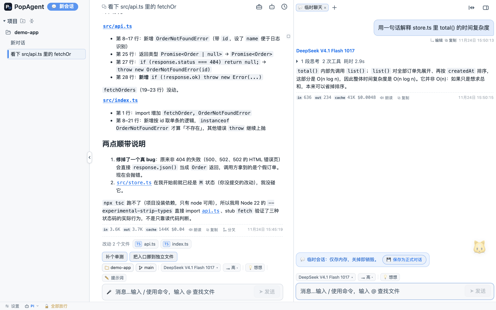

The `Temp session` button in the top bar (or the first card on the right pane's landing page) opens another conversation **in the right pane**:

- **Not persisted**: it lives in memory, dies with the tab, never enters the sidebar and leaves no file;
- the main conversation keeps running; the two don't interrupt each other;
- to keep it, hit `Save as a regular chat` — only then is a session file written (history the ephemeral chat never had is preserved too);
- you can have several open at once, each on its own channel and its own tab.

> This depends on the engine having an in-memory session: pi supports it; a Codex thread already lives in Codex's own store, so there is no "save" button. It is not "a new session in a different skin", and it is not a subagent — **an ephemeral chat is a window you opened, a subagent is a subtask the agent dispatched**.

---

## Files, diffs, git, search

The files area sits at the bottom of the sidebar and also works as a tab in the right pane. **The web side is read-only**: you can look, compare, reference and search; editing files in place and saving them is not this layer's job — give that to the agent's tools or the terminal, and use the diff here to review it.

| Capability | Notes |
|---|---|
| Directory tree | Switchable root (follow the session / pick a project), lazy loaded, at most 500 entries per directory, `node_modules` / `.git` / `dist` hidden by default, "show hidden files" reveals `.env` and friends |
| Search by file name | Matches names only, never reads contents, 250 ms debounce, at most 200 hits |
| Preview | markdown (tables / code highlighting / mermaid), source with line numbers, images, PDF, audio and video streams; multiple tabs, drag to reorder, right-click to close left / right / all, and it can be spread over the full width |
| Line references | Select lines → "Add to conversation" writes `@path:line`; a text selection can also be "copy selected text" |
| Reveal in Finder | macOS `open -R`, Windows `explorer.exe /select,`, Linux opens the parent directory |
| Uncommitted changes | Status dots in the file tree, plus `M` / `U` / `D` after the filename |

### Diff

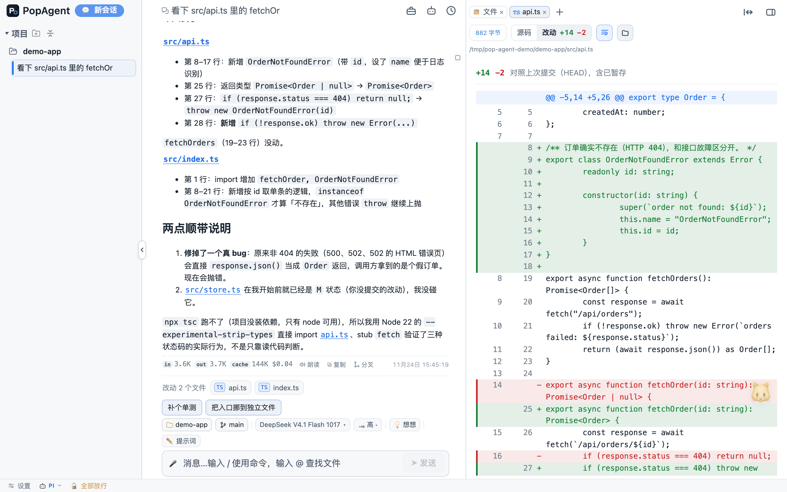

The "diff" toggle at the top of the preview is a comparison against `HEAD`: a `+285 −78` summary, line-level red/green, and a switch between "changes only" and the full file. Coming in from a changed-files chip lands directly on the diff.

### git

The branch chip at the top of the files area lists local branches and switches them (a dirty working tree asks first). It only shells out to `git` for reads and branch switches — it never commits. Committing stays with the agent, or with you in a terminal.

### Content search

"Search file contents" in the toolbar is a full-text search: add a **path mask** (such as `web/src/**`) to narrow it, results show `file:line` plus a snippet of the source, and clicking one jumps to that line. When there are too many hits it truncates at the cap and says so.

---

## Terminal

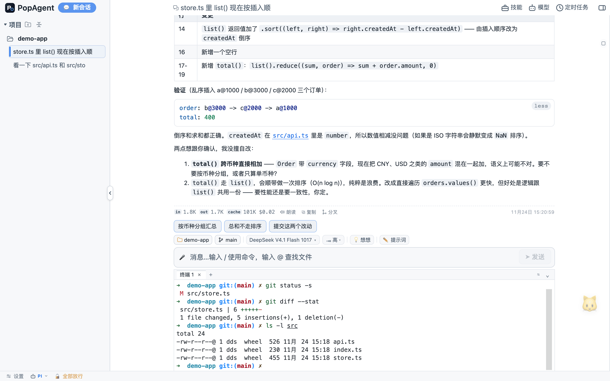

The terminal in the right pane is a **real PTY** (`node-pty` + xterm.js): vim / top / Ctrl-C / colors / line editing all behave, the cwd matches the session's project, and you can pass one initial command (the upgrade flow uses exactly that).

Reloading the page does not restore a terminal session (the PTY exits with the page); switching tabs does not break it. On Linux `node-pty` has to be compiled in place, and when the tools are missing the UI says exactly what to install.

### Built-in web page

The right pane also opens web pages: type a URL and view it in an iframe, with requests going through **a local proxy** (`/web/p/<url>`) — it fetches the document and strips the `X-Frame-Options` / CSP framing restrictions, so sites like Baidu open too. The proxy has boundaries: HTML/CSS documents only, **no cookies in and none out**, a 12 MB upstream cap, and an iframe sandbox without `allow-same-origin`. For sites that need a login or heavy JS, hit `⧉` to jump to the system browser.

---

## Engines: each runs its own native loop

The engines are not "the same prompt in different costumes" — each is that vendor's own agent loop:

| Engine | How it's wired | Notes |
|---|---|---|
| **pi** (default) | Native SDK | The full plugin / skill ecosystem, lazy tool loading, the approval gate, subagents, **native steering**; models and providers are managed by this workbench |
| **Codex** | app-server (JSON-RPC) | Its own loop and sandbox; sessions are shared with Codex Desktop / CLI; approvals are command- and file-level |
| **DeepSeek Harness** | ACP | Model and thinking level are switchable; permissions confirmed one by one |
| **opencode** | ACP | Its own tools / MCP / plugin ecosystem; sessions are shared with the opencode CLI / TUI; approvals follow opencode's own `permission` config |
| **Claude Code** | ACP (the `claude-code-acp` adapter) | Switchable models, per-call tool confirmation; sessions are shared with the `claude` CLI; this ACP surface exposes neither thinking levels nor subagents |
| **fake** | Built-in scripted engine | Zero tokens, only for exercising the protocol / tools / approval flow (not in the picker by default) |

The differences (the capability matrix in `server/engine/registry.ts`, which the UI uses to hide buttons):

| Capability | pi | codex | dsh | opencode | claude |
|---|:-:|:-:|:-:|:-:|:-:|
| Approvals | ✅ | ✅ | ✅ | per config | ✅ |
| Model / thinking level | ✅ | ✅ | ✅ | ✅ | model only / no levels |
| Resume past sessions | ✅ | ✅ | ✅ | ✅ | ✅ |
| Steering | ✅ native | ✅ interrupt | ✅ interrupt | ✅ interrupt | ✅ interrupt |
| Subagent panel | ✅ | — | — | — | — |
| Workbench-managed providers | ✅ | — | — | — | — |
| Side chat (in memory) | ✅ | — | — | — | — |

**The models / plugins / MCP panels follow the active engine**: switch to Codex and the panels read Codex's own data (`model/list`, `plugin/list`, `config/read`); claude reads `~/.claude.json` and `~/.claude/settings.json`; opencode reads `opencode.json`. A panel that has nothing wired says so instead of borrowing pi's config.

Engines are switched in the **bottom status bar** (not the top bar), and every session remembers its own engine, model and thinking level.

---

## Models and providers

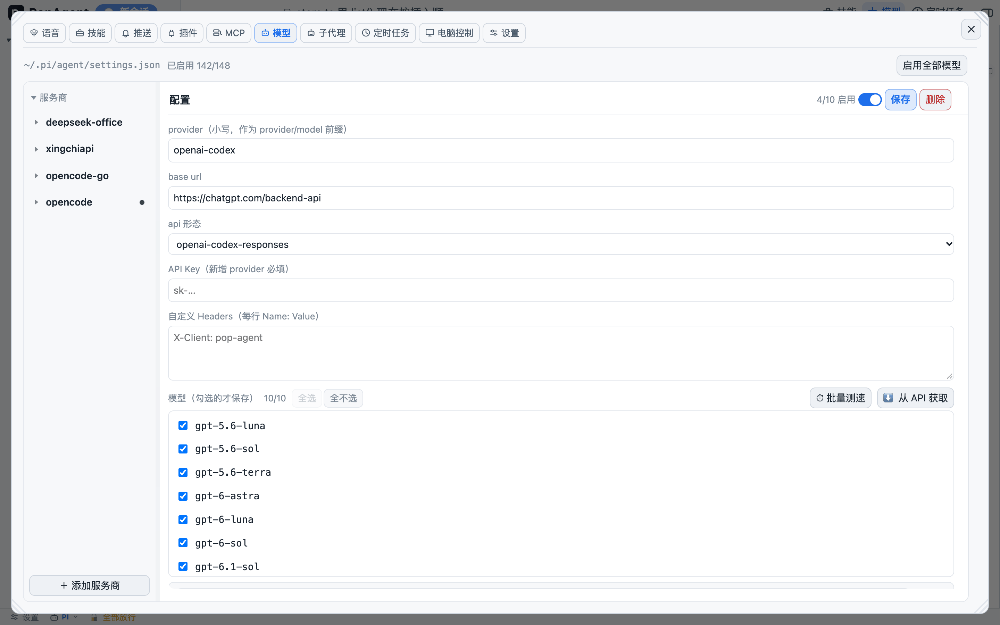

- **Subscriptions**: OAuth login (9 providers), usable right after signing in — no key to copy by hand.
- **Official built-ins**: the ones pi's catalog carries models for — **paste one key and it works**; endpoints and model tables come from the catalog.
- **Bring your own**: change the API shape (openai-completions / responses / anthropic-messages / codex / typesafe), the base URL and custom headers, and add models one by one.
- Tick models individually (only ticked ones are saved), batch-test connectivity, pull the list from `/models`, and save the ticked set as the allowlist.

**Keys never leave the server**: the API returns only `hasKey` and the last 4 digits; writes are serialized inside the process so concurrent edits can't corrupt a file.

The truth is spread across `~/.pi/agent/models.json` (the provider catalog), `models-store.json` (the legacy location) and `auth.json` (`api_key` or OAuth credentials), with the allowlist in `settings.json.enabledModels`.

---

## Skills

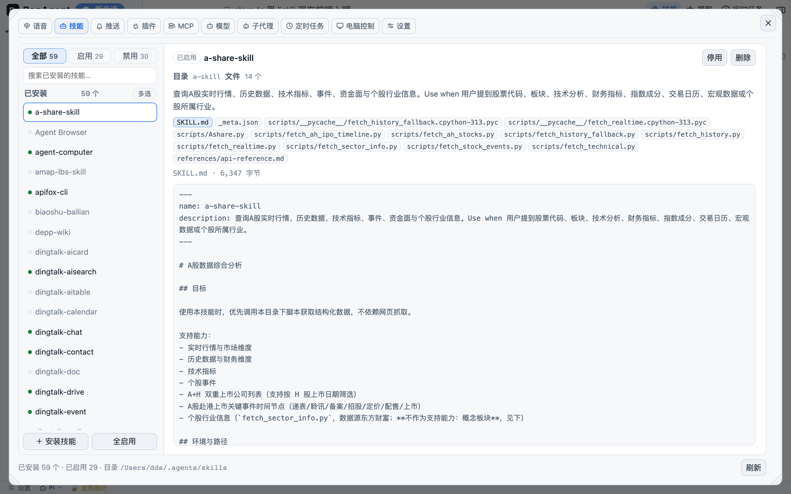

Reads `~/.agents/skills/<dir>/SKILL.md`; the list parses frontmatter only (no yaml dependency). **Enabling or disabling means renaming `SKILL.md` to `.SKILL.md.disabled`** — there is no second state file, so what you see in the CLI agrees with what you see here.

**Skill Hub**: search by category plus one-click install (200k+ index); it can also install a specific `skills/<name>` from a Git repo, or create one by hand.

---

## MCP

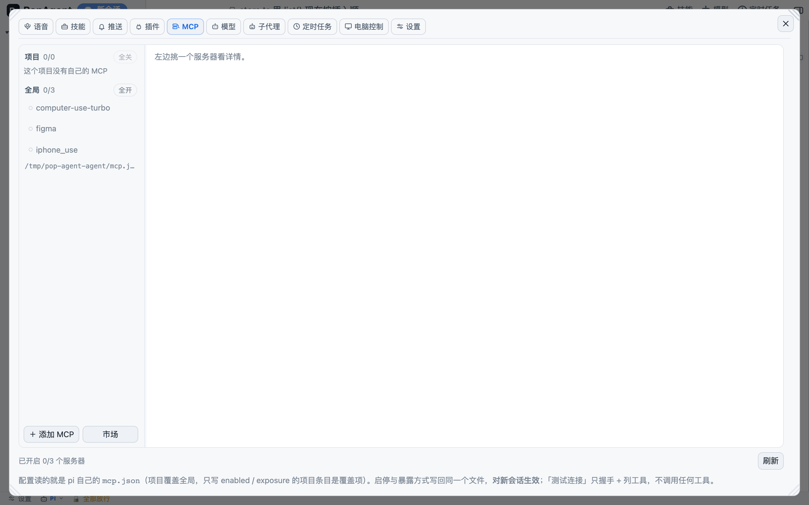

Reads and writes two config files: `~/.pi/agent/mcp.json` (global) and `<workspace>/.pi/mcp.json` (project), where **a project entry with the same name overrides the global one**, and writes preserve indentation and CRLF.

- exposure has four levels: **codemode (default) / deferred / direct / hidden**;
- **Test connection**: a real handshake plus `tools/list`, then disconnect; it reports the connection state and the tool count;
- OAuth login, pick a server from a marketplace, paste a command / URL / JSON and let it be parsed;
- **the config is the truth**: pi connects at session start, so edits apply to **new sessions**.

---

## Plugins

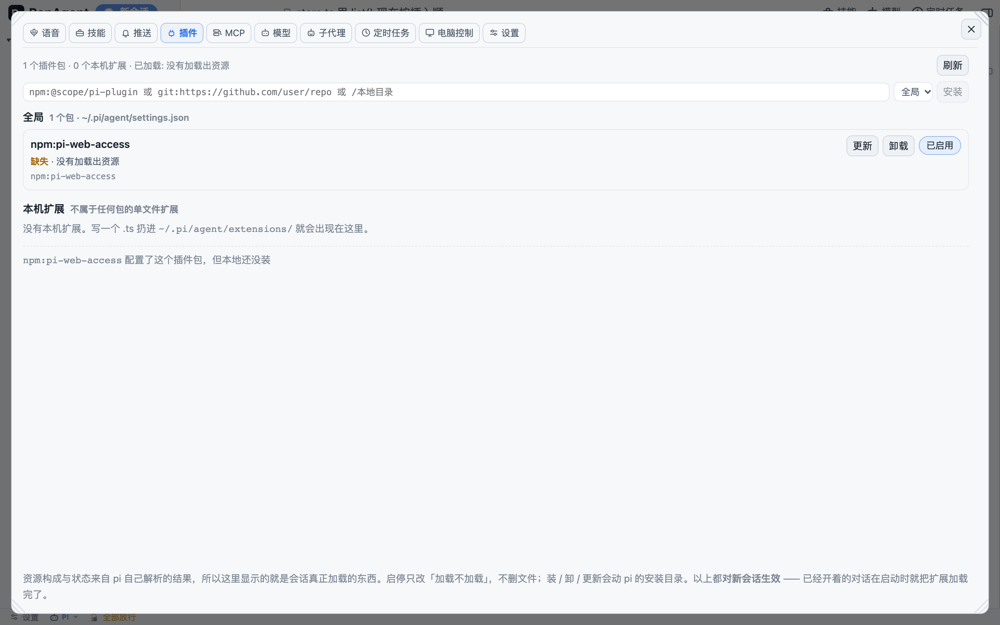

Plugins are pi packages: the `packages` entry in `settings.json` (npm / git / local directory) plus the loose `~/.pi/agent/extensions/` and `<ws>/.pi/extensions/`.

State comes from the pi SDK's `resolve()` (**querying never triggers `npm install`**), with four states `loaded / installed / missing / disabled`; disabling per package writes `autoload:false` and deletes nothing.

---

## Subagents: run many, manage each

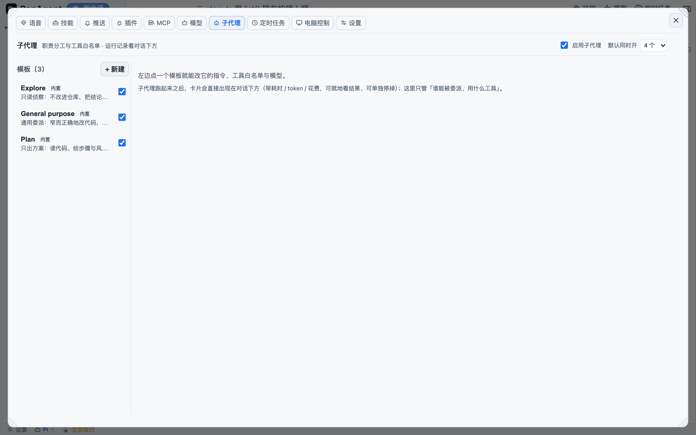

Once the main agent has the `Agent` tool it can run several subagents in parallel, and each one is **a real session** (its own context, session file and tool allowlist).

- **Watch**: the subagent card strip above the composer — status, duration, tool count, tokens, cost. "View result" expands the raw result and the session file path in place, and any single run can be stopped. The heading gives the at-a-glance count (`2 running` / `8 finished`).
- **Manage**: the top-bar "subagents" panel manages **templates** (built in: explore / general-purpose / plan, each disableable; you can also create, edit and delete your own): `name / display_name / description / tools / model / thinking / max_turns`. They land in `~/.pi/agent/agents/*.md`, in the same format as pi's agent files — readable, editable, git-friendly.
- **Concurrency**: 1–12 (default 4); anything beyond that queues. Turn the master switch off and the model no longer sees the `Agent` tool.
- **Isolation**: subagents load no skills / plugins / themes / context files by default (fast and predictable); a subagent that doesn't pin a model keeps using the parent session's model.

A subagent's session file is archived next to the parent session (`<parent session dir>/<parent name>/subagents/`) and never shows up in the sidebar's project list.

---

## Push

**Push**: Web Push (VAPID) subscriptions, one notification per finished turn — title is the project, body is the session, with a ❌ / ⏹ prefix for failures and interrupts. Multiple devices, a test push, and a one-click clear-all. Needs https or localhost.

The VAPID key pair and the contact (subject) are managed in the same panel: the pair is generated on first start into `<dataDir>/vapid-keys.json` (0600, overridable with `VAPID_PUBLIC_KEY` / `VAPID_PRIVATE_KEY`), the contact is stored in `<dataDir>/push-config.json` (overridable with `VAPID_SUBJECT`).
**The subject must be a real email or an https site**: the default `mailto:noreply@localhost` is rejected by Apple with `403 BadJwtToken` (Chrome/FCM ignores it, so the usual symptom is “works on the desktop, silent on the iPhone”). Replacing the key pair invalidates every subscription (the panel clears them; re-register each device). Changing the contact invalidates nothing.

## Voice

Four event sounds (start / finish / error / waiting for approval) with preview and adjustable volume; TTS reads the final reply, with adjustable rate and voice. By default speech output is the **browser's built-in voices** — offline, nothing leaves the machine; switch the speech engine to `edge` (Microsoft, needs network) or point it at your own `kokoro` / `qwen3` in the same panel.

Speech input lives here too: tap the mic bubble to dictate and the text lands in the composer as you speak (drag the bubble anywhere); "send when I stop talking", the silence threshold, how long to wait before sending and continuous dictation are all in this panel.

### Which engines are the default (read this before handing the project to someone)

| | Default | What the other machine needs |
|---|---|---|
| **Voice input** (speech → text) | `Auto`: local on-device first (macOS `SFSpeechRecognizer`); when the local engine isn't installed or fails it goes **straight to Chrome's built-in** recognizer (no toast, no wasted round) | Local: the machine **running the server** is macOS — click **Install it** in Settings → Voice once (it downloads a small helper app; no Xcode needed), one “Speech Recognition” prompt on first use. Chrome: the browser can reach Google |
| **Voice output** (text → speech) | The **browser's built-in** voices (macOS system voices / Windows SAPI), offline | Pick `edge` (Microsoft, needs network) or host `kokoro` / `qwen3` yourself (Voice → Remote) |

So “the defaults are Google + Microsoft” is only half true: input is **not** Google by default (local first, Google is the fallback), and output is **not** Microsoft by default (system voices; edge-tts is opt-in).

Three things people trip on:

- **Local recognition runs on the server machine** (the browser only streams audio), so on a Linux / Windows host the local engine simply isn't available and Chrome's engine is all that's left;
- Opening the app over plain LAN `http://` on a phone gives you **no microphone** (`getUserMedia` requires `localhost` or HTTPS);
- Voice-input settings (near-field gate, silence threshold, keep-listening…) are stored **once per server**, shared by everyone using it — the last edit wins; voice and rate preferences stay in each browser's `localStorage`.

---

## Scheduled tasks: say it once, it runs every morning

A task is a prompt plus a five-field cron expression and a timezone. The panel's schedule picker covers every-N-minutes / every-N-hours / daily / weekdays / weekly / monthly, and anything else goes in as a raw expression (`0 9 * * *` = 09:00 every day).

- **Two kinds of task**: `Text` calls the model directly — no tools, no repo access, the cheapest way to draft something; `Agent` runs a real turn in the workspace (read files, run commands, change code).
- **Where it runs**: every run can open a new session, or continue an existing one you pick from the list (same context, model and workspace); the model follows that session's model, or the project default.
- **Unattended means unattended**: an agent run is registered as `deny-writes`, because an approval prompt at 3 a.m. has nobody to answer it. Writes are refused unless the task explicitly ticks "allow file writes", and a run that reaches the 20-minute timeout is interrupted and recorded as a **failure** — never as half a result.
- **Created from the chat as well**: on the pi engine the agent has a `cron` tool (`add / list / update / remove / enable / disable / run_now / preview`). Say "check this repo's changes every morning at 9" and it fills in name, workspace and timezone from the conversation — defaulting to **this** session, so the task keeps your context. `list` / `preview` are read-only, the rest ask for approval, and `run_now` is always explicit: it won't "just try it once".
- **One source of data**: `<dataDir>/cron.json` (`jobs` + `runs`). The panel refreshes every 5 s, so tasks the agent created appear on their own, and each run keeps its trigger (manual / scheduled), status and text result.

> The `cron` tool is pi-only (ACP engines have no `registerTool`); the panel itself works with every engine. And a task's own turn can't create tasks — unattended cron calls are denied.

---

## Computer control: let the agent drive your Mac

**macOS only**, and it needs a local helper — *Agent Computer.app* — which the panel looks for in `/Applications` and `~/Applications`. When it's missing the panel says so and links the download; when it's there you get a real status block: installed path, running + version, **Accessibility**, **Screen recording**.

- **The master switch is the skill**: turning it on writes `~/.agents/skills/agent-computer`, so *any* engine that has bash can drive the Mac — not just pi. Turning it off renames the skill to disabled; nothing is deleted.
- **What it can do**: read the numbered accessibility tree plus a window screenshot, click by element number (`AXPress`, coordinates as fallback), type / fill / paste (long text goes through the clipboard and your clipboard is restored afterwards), send key combos (`cmd+s`), scroll, drag in steps, run menu commands, and wait for the UI to settle between steps.
- **What it refuses**: password fields (`AXSubrole` is secure, or the placeholder looks like a password) are never typed for you; apps that system authentication and System Settings protect stay protected unless you list them under "unprotected apps", and password managers still ask you inside the helper.
- **What shows on screen**: an optional live preview window, an activity watermark and a pointer ring following the cursor, plus "borrow the foreground briefly" and "activate the target app while you are idle". Pointer speed and the delay between typed keys are adjustable — too fast is exactly what makes an app drop input.
- **Settings live with the helper**: the panel writes the helper's own `~/Library/Application Support/AgentComputer/settings.json`, with no second copy. The file is the truth and the panel is just a form.

---

## Settings

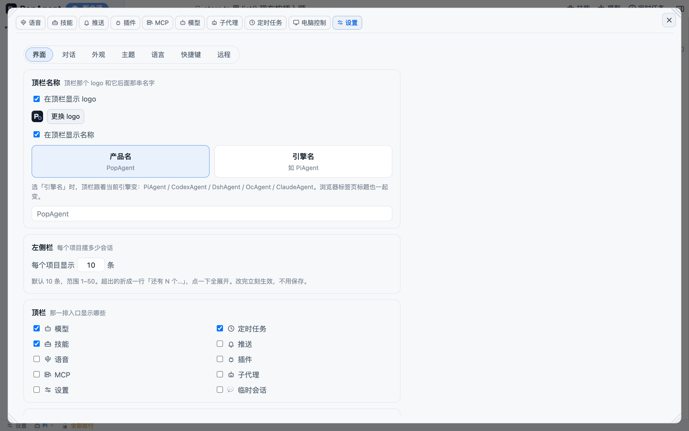

The top bar is the entry point for every panel, and **each entry can be hidden in Settings → Interface**. A fresh install ticks only **models / scheduled tasks (cron) / skills**; push, voice, plugins, MCP, subagents, settings and the temp session are ticked back on when you want them (the top-bar Settings button starts hidden — the leftmost chip in the bottom status bar opens the same panel). The bottom status bar starts with **settings / engine / approval mode** only; queued, running, context, full history, system prompt, terminal and the top toggle come back from Settings → Interface → Bottom, where you can also drag to reorder. The sidebar and the right pane both drag wider and collapse, and their widths are remembered locally in `localStorage`.

The "settings" button opens six pages, and the tabs themselves drag to reorder — **whichever sits first is the page that opens next time**:

| Page | Contents |
|---|---|
| **Interface** | The frame: which top-bar entries show (text and icon ticked separately), which status-bar chunks show (queue / working / context usage), how many sessions each project lists in the sidebar, and the max width of images in the chat |
| **Conversation** | What the chat area itself looks like: which blocks sit above the composer (templates / think / quick commands), the text of your quick phrases and the default thinking level (these two are saved server-side, identical on every device), whether cost shows in the conversation, and whether thinking blocks and tool cards start expanded. **Built-in prompt templates and the default quick phrases (Continue / Summarize) are stored twice — Chinese original plus English**: an English UI shows the English copy (and inserts / sends it, not just the card titles); templates and phrases you edited or created yourself are never auto-translated |
| **Appearance** | Sizes and the front door: three font sizes (chat body / sidebar project names / sidebar session names, slider 2–30px, default “Default” 14px), content width in 4 steps (720 / 900 / 1100 / full, default “Default” 900px), and the top-bar name plus logo. **The name has two modes**: the product name (`PopAgent`, which you can rename — clearing it falls back to the default) or **the engine name**, which follows the current engine (`PiAgent` / `CodexAgent` / `DshAgent` / `OcAgent` / `ClaudeAgent`) so several windows or a switched engine make it obvious who you are talking to. The logo is replaceable and both can be hidden; the top-bar height is now fixed to the standard size (no scaling) |
| **Theme** | 6 palettes (bright white, warm paper, mist teal, Tokyo night, mocha, nord) — one click and it applies |
| **Language** | Chinese / English, applied immediately |
| **Shortcuts** | 19 actions **grouped by function** (session / conversation / panels & views / voice), rebindable, clearable and restorable to defaults, plus a cheat sheet |

A seventh tab, **Remote**, is where the access password, the login guard (3 tries / 30 minutes by default) and the sign-in activity list live — see the phone and security sections.

Appearance, theme, interface and language preferences stay on the device only (`localStorage`, with the `pop-agent.` prefix) — one copy per phone, tablet and desktop. Only the quick phrases in "Conversation" are shared across devices.

---

## Mobile

On narrow screens (mobile UA or ≤400px) the layout collapses to a single column:

- the sidebar becomes an overlay drawer (`clamp(260px, 76vw, 340px)`, tap the scrim to close, closes on its own after you pick a session);

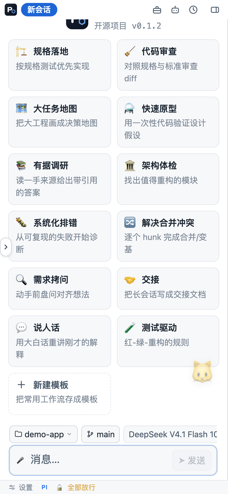
- the top bar wraps, keeps icons only, and scrolls horizontally;
- the right-pane workspace becomes a full-screen second page that starts below the top bar using `100dvh` (dodging the iOS toolbars);
- the composer is 18px so iOS doesn't zoom on focus; the model menu becomes a bottom sheet;
- the status bar scrolls horizontally, and the context-usage popover becomes a full-width sheet.

---

## Sessions: pin, archive, fork, move project

The sidebar groups sessions into "projects" by directory:

| Action | Behaviour |
|---|---|
| Pin | Lifts a session or a project to the top |
| Rename | For pi: append `session_info.name` to the end of the jsonl |
| Archive | Into "archived", undoable |
| Delete | Renames to `.deleted-<timestamp>` (the engine's native delete is preferred when it has one) — **the file is still on disk** |
| Fork | Derive a new session from one message (the title becomes `Branch · …`), the original untouched |
| Move project | Drag a session row onto another project; the id and history stay, only the `cwd` in the file header changes and the directory is moved |

Sorting is a deliberate choice: **newest-created first inside a group** — a new session lands on top, and updating an old one doesn't move it (sort by last activity instead and a single message in an old session shoots it to the top, dragging the whole list along).

---

## Shortcuts and slash commands

**Every shortcut** is rebindable in Settings → Shortcuts (a combo needs `Mod`/`Alt`; a single key only works for one modifier alone — right ⌘ / right ⌥ / ⌃ / Alt — or a function key F1–F12; bare letters are rejected). On macOS `Mod` is ⌘, elsewhere it's Ctrl.

The panel groups them **by function**; defaults:

| Group | Action | Default |
|---|---|---|
| Session | New session | `Mod+Alt+N` |
| Session | New project | `Mod+Alt+X` |
| Session | Temp session | `Mod+Alt+H` |
| Conversation | Send (sends when idle; steers or queues while running) | `Mod+Enter` |
| Conversation | Queue | `Mod+Shift+Enter` |
| Conversation | Steer | `Mod+Alt+Enter` |
| Conversation | Stop the running turn | `Mod+Period` |
| Panels & views | Settings | `Mod+Comma` |
| Panels & views | Open / close right panel | `Mod+Alt+O` |
| Panels & views | Toggle left sidebar | `Mod+Alt+L` |
| Panels & views | Projects | `Mod+Alt+P` |
| Panels & views | Files | `Mod+Alt+F` |
| Panels & views | Canvas | `Mod+Alt+C` |
| Panels & views | Terminal | `Ctrl+Backquote` |
| Panels & views | Search file contents | `Mod+Shift+F` |
| Panels & views | Shortcut cheat sheet | `Mod+/` |
| Voice | Start / stop voice input | `Mod+Alt+M` |
| Voice | Pause / resume reading | `Mod+Shift+P` |
| Voice | Stop reading | `Mod+Alt+S` |

A bare `Enter` is still "send / queue" (the composer's own convention, not one of the four above and not rebindable); only modified `Enter` goes through the shortcut system.

The mic key does both, with no extra setting: **press to keep listening, press again to stop**; or **hold it, say one short thing, release to stop**.

**Slash commands** pop up when you type `/` in the composer. There are two kinds — `local` ones the workbench runs itself, and `to the agent` ones handed to the engine verbatim as a message:

| Command | Kind | What it does |
|---|---|---|
| `/new [first message]` | local | New conversation, optionally with its first message |
| `/skill <skill name>` | to the agent | Use a skill (the panel lists the installed ones) |
| `/compact [note]` | to the agent | Compact the context |
| `/plan [on\|off]` | to the agent | Turn plan mode on or off |

Renaming, switching model, switching thinking level, copying the last reply and session stats are not slash commands — they already have buttons in the UI (double-click the title to rename, the model dropdown, the context ring in the status bar). Keeping one entry point per action is cheaper to maintain than two.

---

## Architecture: SSE + RPC, no WebSocket

```
browser ──GET  /api/events (SSE)──▶ server   one snapshot first, deltas afterwards
        ──POST /api/rpc   (JSON)──▶         ClientRequest → { reply } consumed in place
```

- **Downstream**: one complete snapshot first, then deltas only. Text arrives as `message_delta` chunks appended block by block; structural changes (tool cards, errors, state) push a fresh snapshot, coalesced in a 60 ms window — snapshots are droppable, events are not. SSE heartbeats every 25 s.
- **Upstream**: `send_message`, `interrupt`, `approve`, `new_chat` (optionally with `ephemeral`), `switch_conversation`, `set_engine` / `set_model` / `set_thinking_level` / `set_approval_mode`, `persist_conversation`, `close_ephemeral`, `fork_session`, `move_session`, `cancel_queued`, `rename_session` and more.
- **The protocol has a single source** in `server/protocol.ts`; the frontend reuses its types, so one definition serves both ends.
- **The snapshot is the only source of truth**: `store.ts` uses `useSyncExternalStore` and replaces everything when a snapshot arrives. Locally only optimistic state survives (`preview` / `draft` / `pendingActive`).
- **Each client sees its own session** (ADR-0033): one server, two devices, each parked on a different conversation; bulk data such as the session list is only sent to a client when that client needs it.

Process model: `cli.ts` parses the flags → `session/lock.ts` grabs `<dataDir>/server.lock` (a live pid refuses to start, a dead pid means taking over a stale lock) → `runtime.init()` → `listen`. `SIGINT` / `SIGTERM` / `/api/shutdown` all go through the same graceful exit (flush, disconnect engines, release the lock).

---

## Where data lives

| Content | Location |
|---|---|
| pi sessions | `~/.pi/agent/sessions/<encoded cwd>/<ISO>_<uuid>.jsonl` (first line `{type:"session",id,timestamp,cwd}`) |
| Codex sessions | Codex's own thread store (`thread/list \| resume \| delete`) |
| opencode / DSH / claude sessions | Their own data dirs (opencode lists per cwd with `session/list`; DSH reads `~/.dsh`; claude reads `~/.claude`) |
| Session titles | For pi, the first user message (reads only the first 60 lines); renaming appends `session_info.name` |
| Workbench state | `<dataDir>/settings.json`, `approval-rules.json`, `cron.json`, `server.lock`, `logs/`, `uploads/`, `push-subscriptions.json`, `vapid-keys.json`, `push-config.json` |
| Skills / subagent templates / MCP | `~/.agents/skills/`, `~/.pi/agent/agents/`, `~/.pi/agent/mcp.json` |
| Computer control | `~/.agents/skills/agent-computer/` (the skill), `~/Library/Application Support/AgentComputer/` (helper config, allowlist, socket, screenshots) |
| Local UI preferences | Browser `localStorage` (`pop-agent.` prefix: theme, font sizes, widths, shortcuts, notes, tabs) |

---

## Security model

- Binds `127.0.0.1` by default and decides identity from the real peer address (`X-Forwarded-For` when a local proxy is in front) plus the `Host` header.
- Identity: a loopback peer **and** a loopback Host → allowed. With no password set, remote requests always get 403. The password is stored in `<data dir>/password` (one plaintext line, 0600) and can be set/changed **only locally** (Settings → Remote, `/setup`, or `-P`); changes apply immediately without a restart. With a password, either the cookie (`pop-agent-auth`, 7 days, HttpOnly) or HTTP Basic will do; failed logins are paused for 30 minutes after 3 wrong tries by default (change it in Settings → Remote: 1–20 tries, 1–1440 minutes; locks are persisted and survive a restart).
- **No domain / IP allowlist**: any domain, public IP, LAN IP or tunnel works once the password is in. The cross-origin check only guards requests that genuinely come from **this machine** (loopback needs no password, so that is the CSRF target); remote requests are already behind the password gate. It judges by the real source address (`X-Forwarded-For` included), so a reverse proxy that rewrites `Host` to `127.0.0.1` does not lock out its own domain.
- Tools and commands go through approvals: **read-only tools** (read / grep / find / ls) and read-only commands pass automatically, everything else is asked per `scopeKey` (tool + executable name or target directory). Choosing "always allow" writes the rule into `approval-rules.json` (atomic write; a corrupt file counts as empty).
- When a turn ends, every pending approval for that session is cleared, so nothing hangs waiting for a human.
- Uploaded temp files and session caches live in the data directory, never in your project.
- The built-in web page's proxy carries no cookies, and its iframe sandbox omits `allow-same-origin` (otherwise remote JS could reach `localStorage` and the RPC endpoint).

> Exposing it remotely is an explicit act: `-H` to be reachable plus a password set locally (Settings → Remote, or `-P`). Domain/IP allowlists are not needed.

---

## Development

From the repo root, run `npm install` first, then:

```bash
npm run dev          # starts both processes with one command
```

- Externally there is still a single port **9090** (Vite listens and proxies); the backend hides on internal **9091**, so dev and production use the same address.
- Frontend HMR via Vite; the backend auto-restarts through `tsx --watch`.
- Phone debugging: `npm run dev -- --host 0.0.0.0`.

| Command | Purpose |
|---|---|
| `npm run typecheck` | Two `tsc --noEmit` runs: server + web |
| `npm run lint` | oxlint over `server` / `web/src` / `scripts` |
| `npm run format` | Prettier across the repo (`format:check` only checks; `*.md` is deliberately skipped) |
| `npm run build` | Server `tsc` + frontend `vite build` into `web/dist` |
| `npm run icons` | Regenerate the PWA icons with playwright-core |

Two workflows, no separate `ci.yml`:

- `.github/workflows/release.yml` (on `v*` tags, or manual): `npm ci` → typecheck → lint → build → `npm pack --dry-run` → `npm publish` (OIDC). Unit tests and `format:check` are **not** gating yet.
- `.github/workflows/pages.yml` (on `docs/site/**`): publishes the landing page to GitHub Pages as-is.

Unit tests are run locally: `node --import tsx --test tests/unit/*.test.ts`.

---

## Troubleshooting

> **Why `npm ci` and not `npm install`**: the direct dependencies are all very new, and `npm install` re-resolves the version ranges against the registry — if your mirror (corporate Nexus, npmmirror, …) hasn't synced those versions you get `npm error notarget`. `npm ci` uses the exact versions from the lockfile.

1. `npm error notarget No matching version found` → the mirror is behind. Check `npm config get registry`, then fall back to the official one: `npm -g install pop-agent --registry=https://registry.npmjs.org/`.
2. `EBADENGINE` / a Node version complaint at startup → you need Node ≥ 22.19 (check with `node -v`).
3. `node-pty` fails to build (mostly on Linux) → install `python3` / `make` / `g++` before `npm -g install`, or let the one-line installer handle it with `--with-build-tools`.
4. It won't start but `pop-agent status` mentions a stale lock → a previous process didn't exit cleanly; the next `start` takes over automatically. If it's truly stuck, delete `<dataDir>/server.lock`.
5. Port already in use → `pop-agent -p 9191`, or run `pop-agent stop` first.
6. The built-in web page is blank → that site needs a login or heavy scripts, and the proxy does not tunnel cookies; hit `⧉` to use the system browser.
7. `engine.provider_error: This operation was aborted` (occasional) → the **transport** was cut (the model had just connected, a proxy swapped connections, the request body was reclaimed), not the model refusing. Transient errors like this are now retried twice automatically (1 s / 3 s backoff, with only one "retrying" line in the UI) and a successful retry ends with no error at all. If it still fails, search `<dataDir>/logs/pop-agent.log` for `provider 报错` / `模型调用失败` — every entry carries `sessionId`, `attempt`, `code` and the raw `message` (before this, such errors left nothing in the log at all). Interrupts you caused by pressing Stop are never retried and never turn into a red bar.
8. To see what the engine is actually doing → `POP_AGENT_LOG=info pop`: the SDK's own retry (`pi 自动重试`), a successful retry (`自动重试成功`) and `这一轮被中断` all land in the log.
9. `请求失败：HTTP 502` (or "the backend is restarting or not up yet (HTTP 502)") → this is the **frontend → backend** hop, not a model error: under `npm run dev`, Vite (9090) proxies the backend (9091), and saving a file under `server/` restarts the backend — in that one-or-two-second window `POST /api/rpc` returns 502 (the terminal shows `http proxy error: connect ECONNREFUSED 127.0.0.1:9091`), and the running turn is cut with it (the tell: the last message in the session is a `toolUse` with no `errorMessage`). In dev the backend now retries for 6 seconds when the port isn't released yet, and the red bar clears itself once SSE reconnects; **run long turns with `pop`** (the built `dist`, with no watch restart).

Windows differences in shell resolution, process-tree teardown, path handling, permissions and CRLF are all centralised in three modules: `server/util/spawn-cli.ts` (PATH/PATHEXT, `.cmd` via `cmd.exe`, `killTree`), `server/util/paths.ts` and `web/src/path-utils.ts` (separators and absolute paths), and `server/util/file-mode.ts` (`icacls` on Windows). Read those headers before touching cross-platform code.

---

## License

MIT
