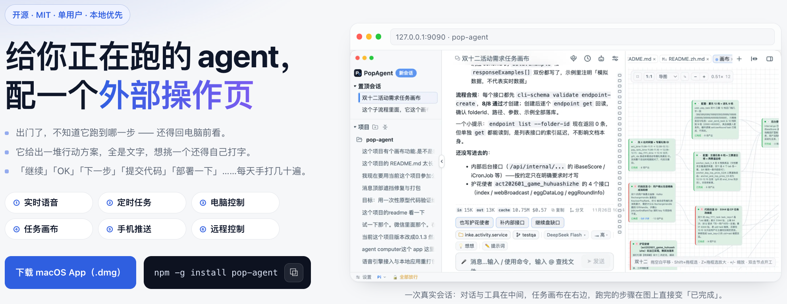
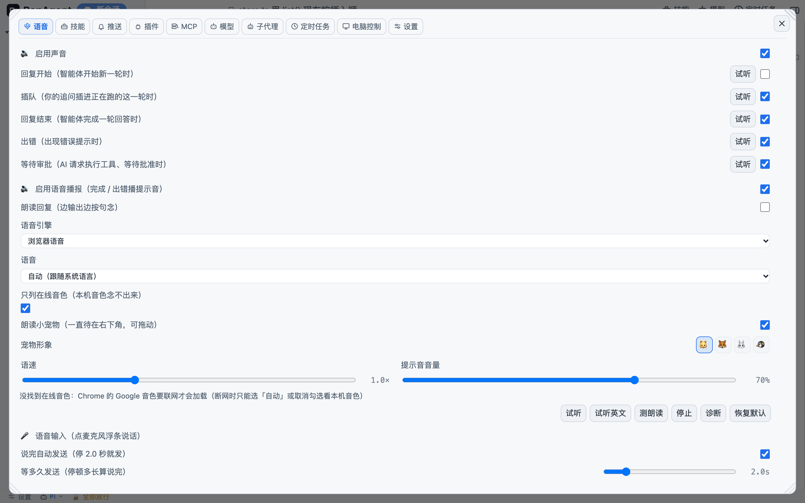
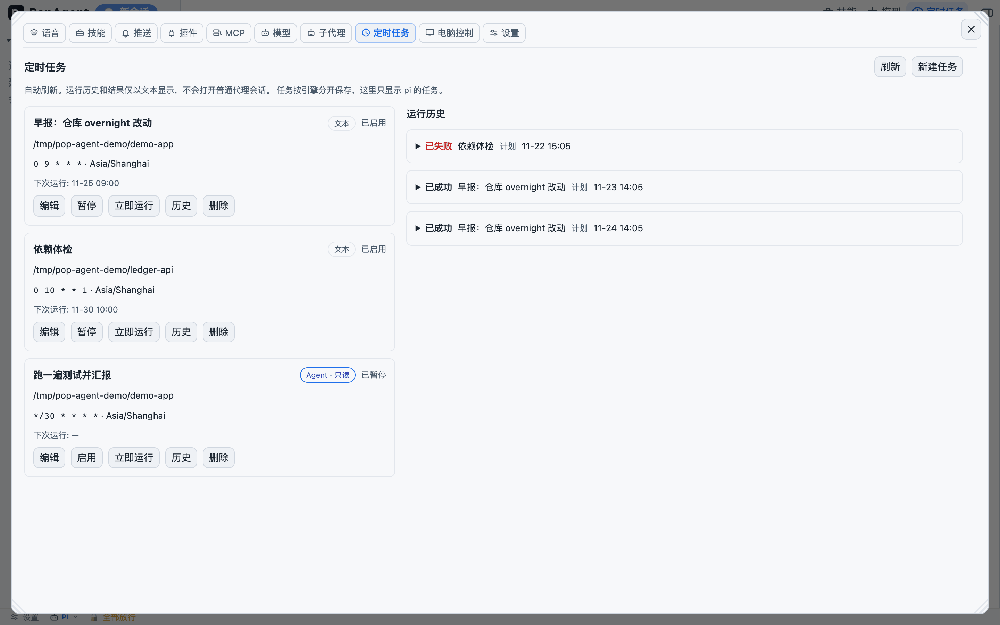
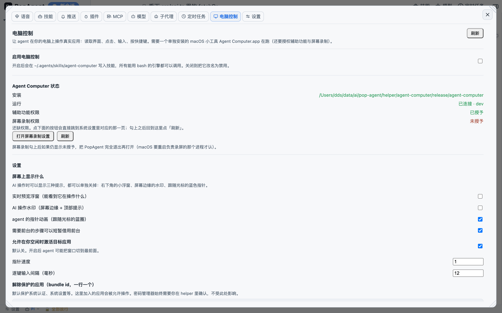
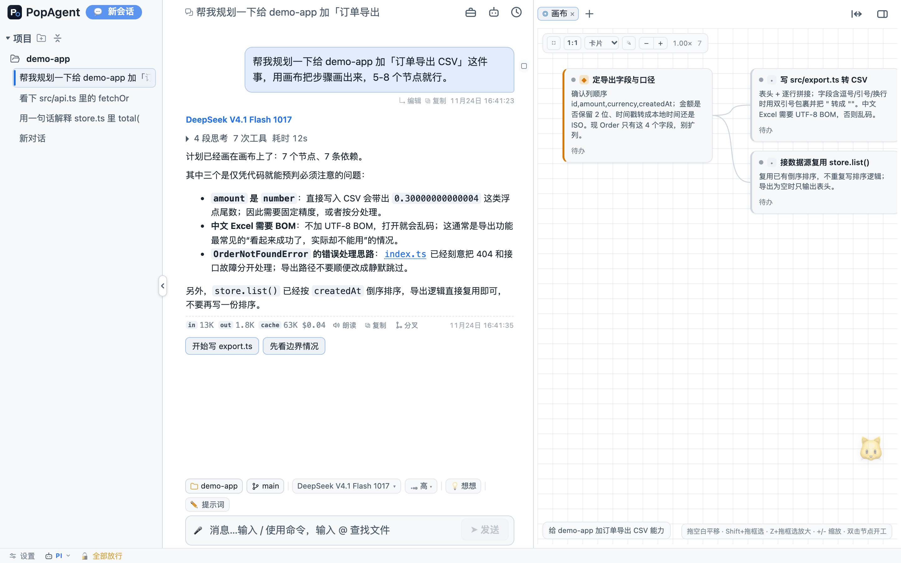
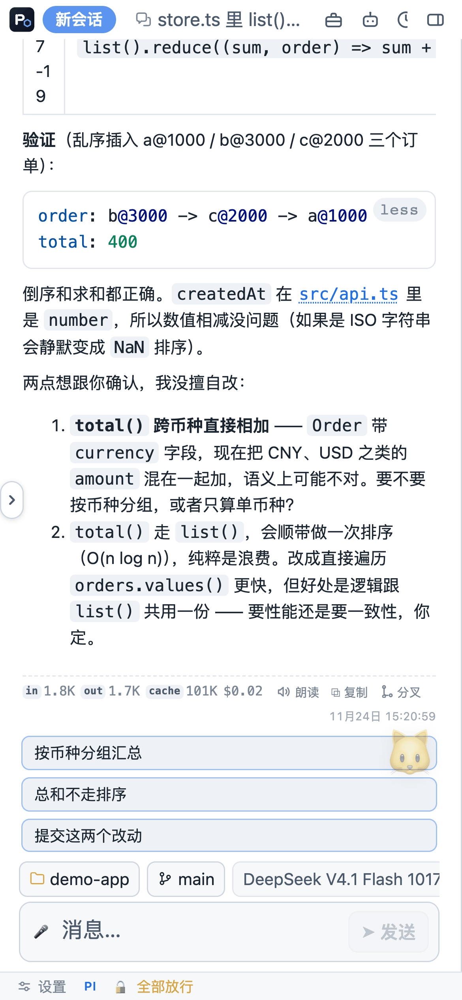

# PopAgent

[](https://github.com/duzhenxun/pop-agent/releases)
[](https://www.npmjs.com/package/pop-agent)
[](https://github.com/duzhenxun/pop-agent/stargazers)
[](https://nodejs.org)
[](LICENSE)

**中文** · [English](README.md) · [官网](https://pop.xs25.cn/zh) · [Gitee 镜像](https://gitee.com/duzhenxun/pop-agent)

---



**下载**：[macOS App（.dmg）](https://github.com/duzhenxun/pop-agent/releases/latest) · **看看界面**：[官网](https://pop.xs25.cn/zh) · **命令行**：

```
npm -g install pop-agent
```

**它是什么**：一个把 agent 的「过程」摊开给你看的前端 —— 思考块、工具调用、改动文件、token 与花费都在对话流里，回合中途能插话；输入框上方还有模板、快捷指令和「想想」，把「怎么开口」也做成能点的东西。

**不是什么**：不是新的 agent 引擎，也不把会话搬到云上的 SaaS。它不重写 prompt、不接管工具实现，只是给你装的引擎配了一套能看的界面、能点的按钮和能落盘的会话列表。三条硬纪律：

| | 纪律 | 含义 |
|---|---|---|
| 01 | **不引数据库** | 会话就是引擎自己写的 JSONL / thread，网页只读它、改名字、必要时删它 |
| 02 | **不假装** | 引擎没有的能力在界面上藏起来（能力矩阵）；面板拿不到数据就直说，不拿别的引擎的配置冒充 |
| 03 | **不越界** | 默认只听 `127.0.0.1`；要远程就显式 `-H 0.0.0.0`，并且先在本机把密码设好 |

---

## 输入那半屏：模板、快捷指令、想想

输入框上方那一排，把「怎么开口」做成能点的东西（都存在服务端，手机电脑同一份）。

- **模板**：12 张内置，点一张落进输入框（不发送）；写不利索让「AI 帮写」补完。
- **快捷指令**：点一下就发，Shift + 点只填不发。
- **想想**：跑个隐藏回合给 1–5 条「下一句这么说」，点一条就发，不进历史。

---

## 六件大多数 agent 前端根本不做的事

语音、定时、电脑控制、画布、推送、远程 —— 都在同一个进程里，不是拼起来的几个工具：它们共享同一套会话、同一个工作区、同一套审批。

### ① 实时语音：说一句，它边听边写；答完自己念出来



- **说话代替打字**：输入框那颗话筒，点一下开始听，**文字边说边进输入框**，不是说完才一次性出现。轻按 = 一直听着（再按停），长按 = 按住说话、松手就发。
- **它答完会念出来**：TTS 播报最终回复，语速音色可调，能暂停 / 继续 / 停止；开始 / 结束 / 出错 / 等审批四类事件各有提示音，可试听、可调音量。
- **默认离线**：识别优先走 macOS 本地（`SFSpeechRecognizer`），朗读用系统语音 —— 不出机器、不联网、不花钱。想统一音色再切 `edge`（微软）或自建 `kokoro` / `qwen3`。

### ② 定时任务：说一句，它每天早上自己跑



- **一个任务 = 提示词 + 五字段 cron + 时区**。`文本任务` 直连模型、不碰仓库；`Agent 任务` 在工作区真跑一个回合（能读文件、跑命令、改代码）。
- **对话里也能建**：你说「每天早上 9 点看一下这个仓库的改动」，agent 自己把名字、工作区、时区补齐并建好。
- **无人值守就按无人值守算**：凌晨三点的审批框没人点，所以默认**拒绝写操作**，除非在任务上显式勾「允许改动文件」；超过看门狗上限会 `interrupt` 并记成失败，绝不把半截输出当成功。

### ③ 电脑控制：让 agent 真的替你操作这台 Mac



- 不是截图猜坐标那套：读 **macOS 辅助功能（AX）的元素树**，按编号点击，所以点得准、看得懂。
- 能点击、输入 / 填值 / 粘贴（长文本走剪贴板，用完恢复原剪贴板）、发快捷键、滚动、分步拖拽、按菜单路径执行命令，每步之间等界面稳定。
- 密码框一律不替你填；系统认证与「系统设置」保护的 App 默认不许动。总开关就是那个技能，所以**任何有 bash 的引擎**都能用，不只 pi。

### ④ 画布：把「接下来要做什么」画成一张图



- 你说一件要多步才能完成的事，agent 把它拆成**节点 + 依赖边**画到右边；节点有类型（任务 / 里程碑 / 风险 / 决策 / 资料），一眼看出哪一步容易翻车、哪一步要你拍板。
- **能点**：开始干某一步标「进行中」，干完标「完成」，进度直接画在图上。
- **能钻进去**：一步里还有好几件小事就用子计划，主图只留汇总。坐标由宿主按依赖分层算好，模型不用管排版。

### ⑤ 手机推送：跑完了手机自己响


- 回合结束推一条：标题是项目名、正文是会话名，失败加 ❌、中断加 ⏹。
- **Web Push（VAPID）**：不依赖任何第三方服务，密钥首次启动自己生成。多设备列表、测试推送、一键清空。
- 在手机上加到主屏就是一个 App（PWA），点推送直接进这条会话。

### ⑥ 远程控制：在外面用手机接着干


- `pop-agent -H 0.0.0.0` 就能从手机 / 别的电脑打开；**密码必须先在本机设**（远程不许设，否则谁先扫到端口谁接管）。
- **登录保护**：同一来源连续输错 3 次暂停 30 分钟（次数与时长可改），锁定期内连密码都不比对，重启服务也不解锁。
- 手机上是真的手机布局：侧栏变抽屉、顶栏只留图标、输入框 18px 防 iOS 自动放大、右栏变整屏第二页。



---

## 多引擎：各跑各的原生 loop

引擎不是「同一个 prompt 换个皮」：每个都接自己的官方循环，能力差异在界面上按矩阵隐藏按钮。

| 引擎 | 接入方式 | 说明 |
|---|---|---|
| **pi**（默认） | 原生 SDK | 完整插件 / 技能生态、工具延迟加载、审批门禁、子代理、**原生插队**；模型与 provider 由本工作台管理 |
| **Codex** | app-server（JSON-RPC） | 独立 loop 与沙箱，会话与 Codex Desktop / CLI 共用；审批是命令 / 文件级的 |
| **DeepSeek Harness** | ACP | 模型与思考档可切，权限逐次确认 |
| **opencode** | ACP | 自带工具 / MCP / 插件生态，会话与 opencode CLI / TUI 共用；审批取决于 opencode 自己的 `permission` 配置 |
| **Claude Code** | ACP（`claude-code-acp` 适配器） | 模型可切、工具逐次确认，会话与 `claude` CLI 共用；这套 ACP 面不暴露思考档与子代理 |

能力差异（`server/engine/registry.ts` 的能力矩阵，界面据此隐藏按钮）：

| 能力 | pi | codex | dsh | opencode | claude |
|---|:-:|:-:|:-:|:-:|:-:|
| 审批 | ✅ | ✅ | ✅ | 看配置 | ✅ |
| 模型 / 思考档 | ✅ | ✅ | ✅ | ✅ | 模型可切 / 无档位 |
| 恢复历史会话 | ✅ | ✅ | ✅ | ✅ | ✅ |
| 插队 | ✅ 原生 | ✅ 打断续发 | ✅ 打断续发 | ✅ 打断续发 | ✅ 打断续发 |
| 子代理面板 | ✅ | — | — | — | — |
| 本工作台管 provider | ✅ | — | — | — | — |
| 临时会话（内存） | ✅ | — | — | — | — |

**模型 / 插件 / MCP 三块跟着当前引擎走**：切到 Codex，面板读的就是 Codex 自己的东西；claude 读 `~/.claude.json` 与 `~/.claude/settings.json`；opencode 读 `opencode.json`。没接的面板会直说，不拿 pi 的配置冒充。引擎在**底部状态栏**切换，每个会话各自记住自己的引擎、模型与思考档。

---

## 装起来

**macOS（Apple Silicon）** → [下载 `.dmg`](https://github.com/duzhenxun/pop-agent/releases/latest) 拖进「应用程序」。**不用装 Node、不用碰终端**，运行时已经打进 App 里。

**其它平台 / 想要命令行** → `npm -g install pop-agent`（要求 Node ≥ 22.19）。装出来的两个命令完全等价：**`pop-agent`**、`pop`（短别名）。Linux 上内嵌终端要就地编译 `node-pty`，需要 `make` / `g++` / `python3`。

**不想碰系统全局 npm**（装到 `~/.pop-agent`，不要 sudo）：

```bash
# macOS / Linux
curl -fsSL https://raw.githubusercontent.com/duzhenxun/pop-agent/main/scripts/install.sh | sh

# Windows（PowerShell）
powershell -c "irm https://raw.githubusercontent.com/duzhenxun/pop-agent/main/scripts/install.ps1 | iex"
```

<details>
<summary>首次打开被 macOS 拦下怎么办</summary>

这套包只有打包时补的 ad-hoc 签名，没有 Apple 开发者签名，所以两种提示对应两种处理：

- **「无法验证开发者」** → `右键 → 打开` 一次即可；macOS 15 及以上也可以去「系统设置 → 隐私与安全性」点「仍要打开」。
- **「已损坏，无法打开。你应该将它移到废纸篓」** → **别扔**，这不是包坏了，是签名和资源对不上。跑这两条：

  ```bash
  codesign --force --deep --sign - /Applications/PopAgent.app
  xattr -dr com.apple.quarantine /Applications/PopAgent.app
  ```

</details>

### 命令

| 命令 | 作用 |
|---|---|
| `pop-agent` | **启动（默认）**：前台跑起来 + 打开浏览器，`Ctrl-C` 退出；默认工作区 = 当前目录 |
| `pop-agent start -d` | 后台运行（脱离终端，日志进 `daemon.log`） |
| `pop-agent status` | 看状态：pid / 端口 / 已运行多久 / 引擎 / 会话数 / 工作区 |
| `pop-agent restart` / `stop` | 先停再起（带 `-d` 则后台）/ 停掉正在跑的实例 |
| `pop-agent upgrade` | 升级到最新发行版 |

```bash
pop-agent                              # 前台起 + 打开页面（最常用）
pop-agent -d                           # 后台起，终端立刻还给你
pop-agent -p 9191                      # 换端口
pop-agent -H 0.0.0.0                   # 局域网/外网可达（前提：已经设过密码）
pop-agent -H 0.0.0.0 -P 'my-pass'      # 直接带密码起
POP_AGENT_CWD=~/code/my-proj pop-agent # 指定默认工作区
```

> **想从手机 / 别的电脑访问**：密码**先在本机设好**（`设置 → 远程`，或打开 `/setup`，或启动时 `-P`）。之后不管用局域网 IP、外网 IP 还是域名访问，输密码就能进，不需要再配白名单。远程访问时若还没设密码，只会看到「请先在本机设置」—— 否则谁先扫到端口谁就接管了。

全部参数与环境变量、各引擎的逃生阀：见 [参考手册 · 参数](docs/reference.zh.md#参数)。

---

## 更多

README 到这里就够了，剩下的都在文档里：

| 想知道 | 去哪 |
|---|---|
| 安装细节、全部参数、面板说明、快捷键、架构、数据落盘、安全模型、开发与排错 | [参考手册](docs/reference.zh.md) |
| 官网（含界面巡览、每个能力的截图） | <https://pop.xs25.cn/zh> · [English](https://pop.xs25.cn/) |
| 界面截图（未压缩原图） | [`docs/screenshots/`](docs/screenshots) |
| 架构决定记录 | [`docs/adr/`](docs/adr) |
| 手机访问与安全模型 | [参考手册 · 安全模型](docs/reference.zh.md#安全模型) |

---

## 感谢

**相关项目** —— 这个工作台是站在这些 node 包上的：

- 引擎与协议：`@earendil-works/pi-ai`、`@earendil-works/pi-coding-agent`、`@earendil-works/pi-mcp`
- 服务端：`express`、`ws`、`web-push`、`node-edge-tts`、`node-pty`（可选，内嵌终端用）
- 界面：`react` / `react-dom`、`react-markdown` / `remark-gfm` / `rehype-highlight`、`highlight.js`、`mermaid`、`@xterm/xterm` / `@xterm/addon-fit`
- 工具链：`vite`、`typescript`、`electron` / `electron-builder`、`playwright-core`、`oxlint`、`prettier`、`tsx`

**感谢我的同事们**：窦欣、李卉萌、宋鹤鹏、陈朝阳、吕琴艳、师超、张冰、覃兆银、王继超

MIT License
