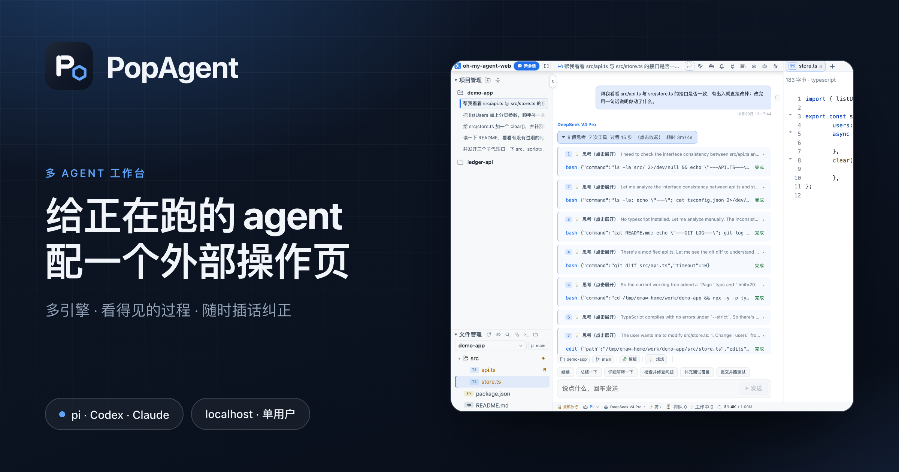
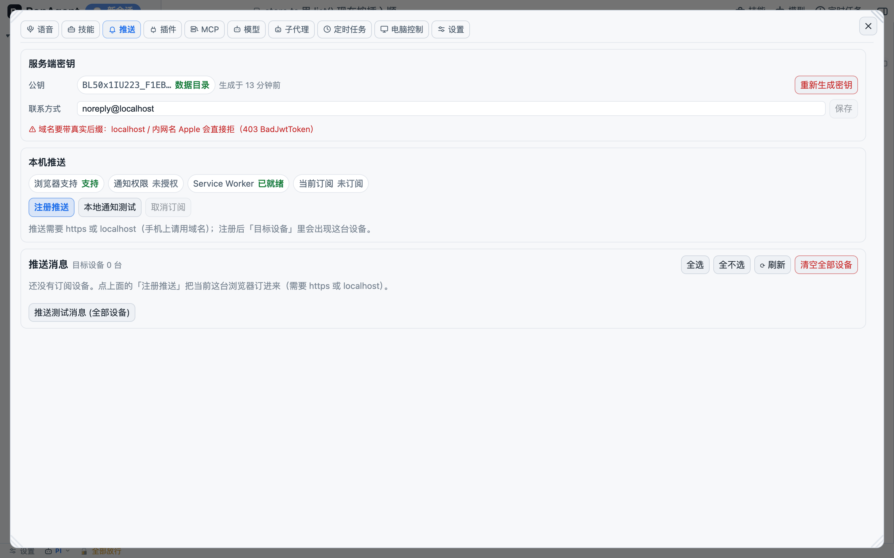
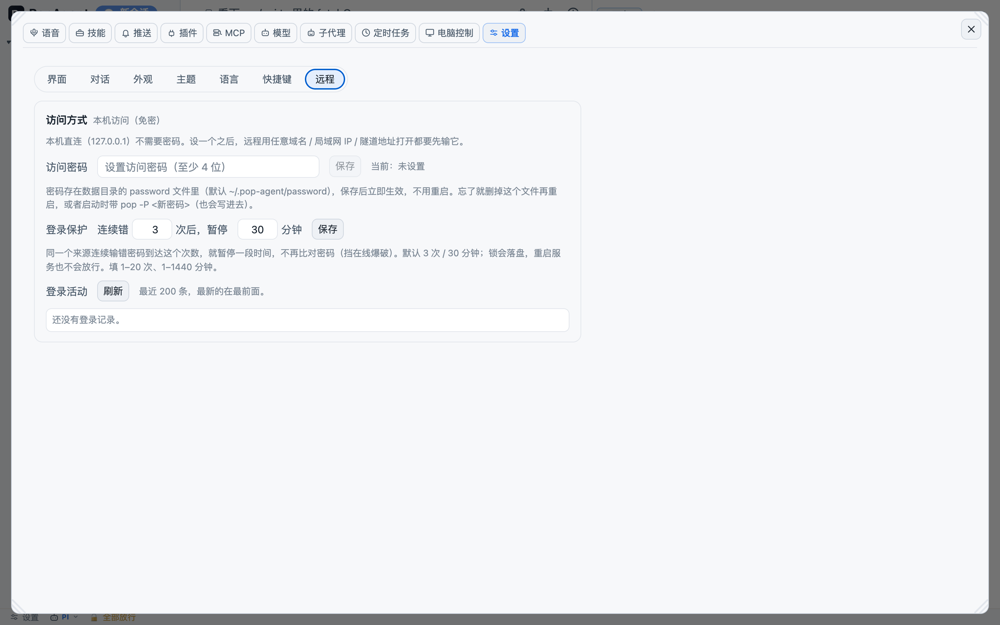
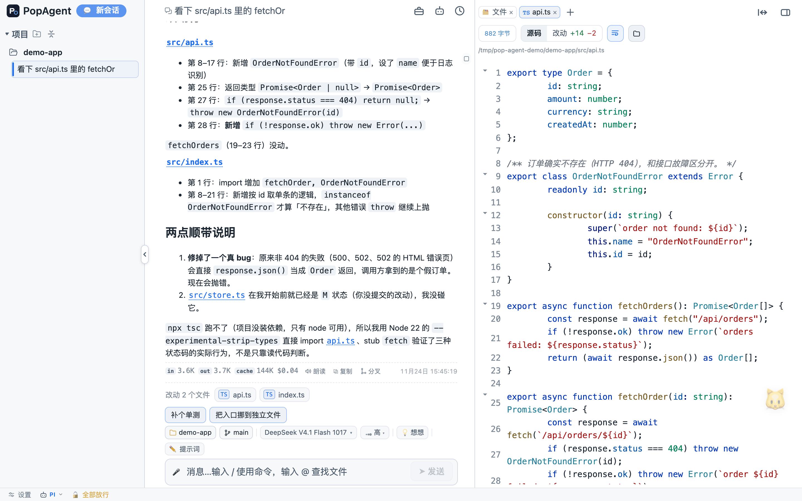
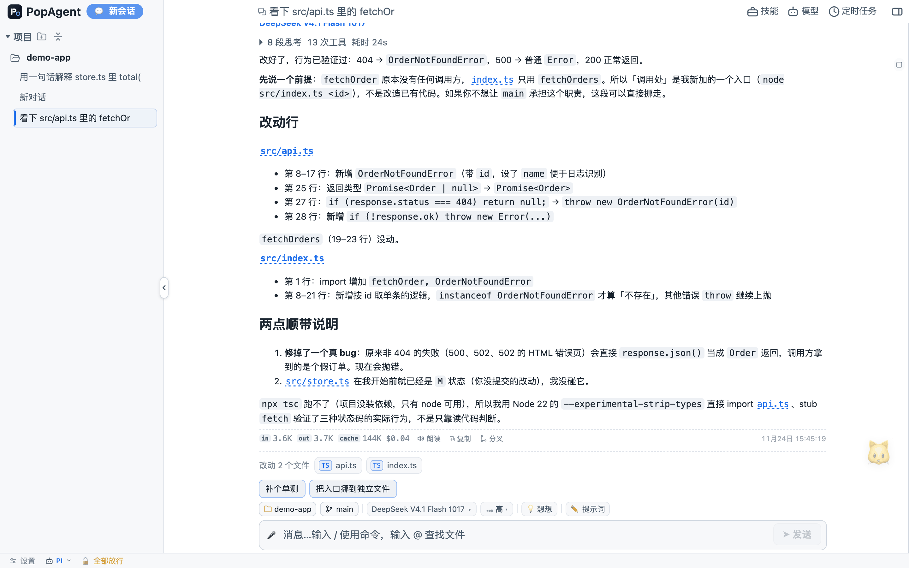
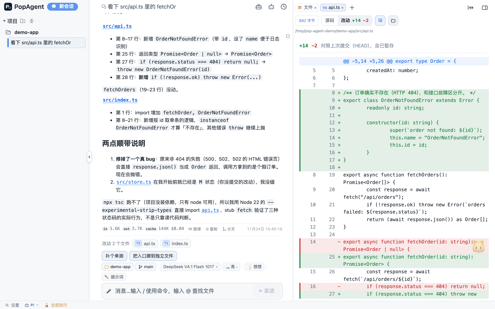
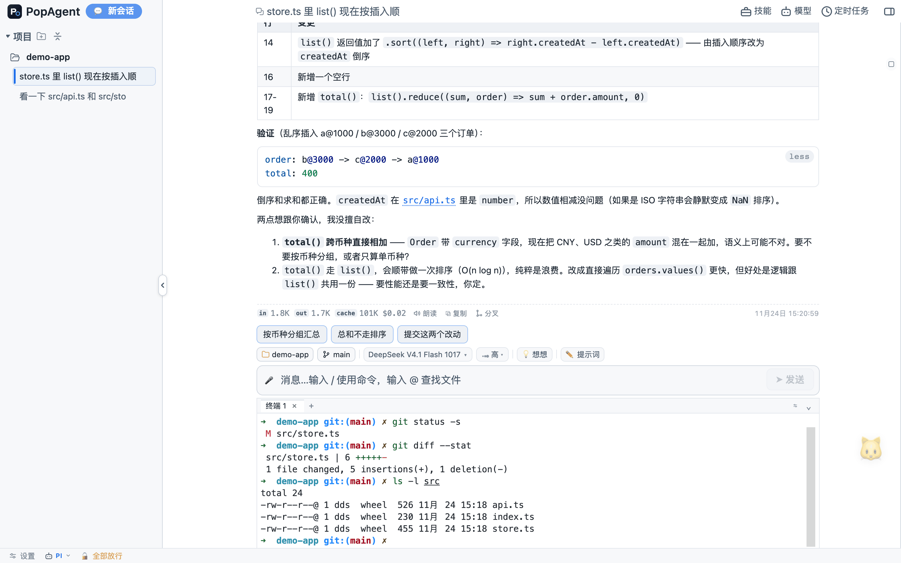
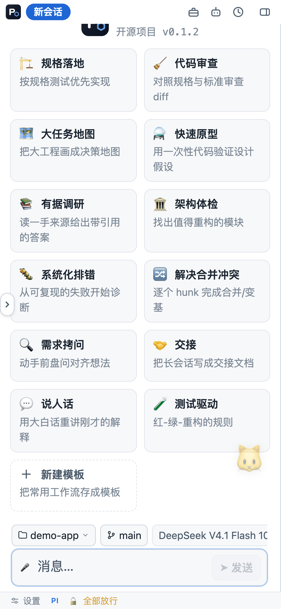

# PopAgent

[](https://github.com/duzhenxun/pop-agent/releases)
[](https://www.npmjs.com/package/pop-agent)
[](https://github.com/duzhenxun/pop-agent/stargazers)
[](https://nodejs.org)
[](LICENSE)
[](https://pop.xs25.cn/zh)

**中文** · [English](README.md) · [官网](https://pop.xs25.cn/zh) · [Gitee 镜像](https://gitee.com/duzhenxun/pop-agent)



一句话：**给你正在跑的那个 agent 配一个外部操作页。** 引擎照旧跑在自己电脑上，你在网页里看着它干活、管它的工具和模型、随时插话纠正，需要时直接翻文件、开终端、圈出一段话让它改。

单用户、只听回环、**会话的事实源永远是引擎自己的落盘文件** —— 不引数据库、不建账号体系、不把会话复制一份到自己的库里。一个 `pop-agent` 进程就是一个人的工作台。

除了"看它干活"，还有几件别人不常做的事，都做完了：**能真的开口说话、能每天自己跑、能替你操作这台 Mac、能把计划画成图、能在手机上收推送、能在外面远程用** —— 见下面的 [六个特色能力](#六个特色能力)。

---

## 安装

### macOS：下载 App 安装包（最省事，不需要 Node）

到 [Releases](https://github.com/duzhenxun/pop-agent/releases/latest) 下载 `PopAgent-<版本>-arm64.dmg`（Apple Silicon），拖进 `/Applications` 就能用 —— **不用装 Node、不用碰终端**。App 里已经带了运行时，装好点开就是一个完整的工作台。

> Intel Mac 暂时只有 npm 那条路（见下面），或者用 Rosetta 跑 arm64 包。

首次打开可能被系统拦，两种提示对应两种处理（这套包只有打包时补的 ad-hoc 签名，没有 Apple 开发者签名）：

- **「无法验证开发者」** → `右键 → 打开` 一次即可；macOS 15 及以上也可以去「系统设置 → 隐私与安全性」点「仍要打开」。
- **「已损坏，无法打开。你应该将它移到废纸篓」** → **别扔**，这不是包坏了，是签名和资源对不上。在终端跑这两条就好：

  ```bash
  codesign --force --deep --sign - /Applications/PopAgent.app
  xattr -dr com.apple.quarantine /Applications/PopAgent.app
  ```

### 其它平台 / 想要命令行：npm 全局安装（推荐）

```bash
npm -g install pop-agent
```

不带版本号装的就是当前发行版。要钉版本或用镜像：

```bash
npm -g install pop-agent@latest
npm -g install pop-agent@<版本号> --registry=https://registry.npmmirror.com
```

装出来的两个命令指向同一个入口，完全等价：**`pop-agent`**（下面统一用它）、`pop`（短别名，打字省事）。

升级与卸载：

```bash
pop-agent upgrade               # 等于 npm -g install pop-agent@latest
npm -g uninstall pop-agent      # 卸载；~/.pop-agent 里的数据不动
```

Linux 上 `node-pty`（内嵌终端）只给 macOS / Windows 带预编译产物，Linux 要就地编译：需要 `make` / `g++` / `python3`。缺工具时页面和安装脚本都会直说缺什么，装完终端才开得起来。

> **npm 11.16+ 的 `allow-scripts` 提示**：新版 npm 会把「未经你批准的 install 脚本」逐条列出来（`npm warn allow-scripts ...`）。本包**自己没有 install 脚本**（以前那个只用来裁 node-pty 无关平台的预编译产物，现在改到启动时顺手做），所以列表里出现的只会是传递依赖，例如 `node-pty`（要编原生模块）、`protobufjs`、`@google/genai`。这只是一条**提示**，安装照常完成；想让它闭嘴就审一下并批准：`npm approve-scripts node-pty protobufjs @google/genai`（或 `npm approve-scripts --all`）。

### 一行脚本（不想碰系统全局 npm）

macOS / Linux：

```bash
curl -fsSL https://raw.githubusercontent.com/duzhenxun/pop-agent/main/scripts/install.sh | sh
```

Windows（PowerShell）：

```powershell
powershell -c "irm https://raw.githubusercontent.com/duzhenxun/pop-agent/main/scripts/install.ps1 | iex"
```

脚本做四件事：**找一个够新的 Node**（没有就下官方包到 `~/.pop-agent/node`，校验 sha256）、**`npm install -g --prefix ~/.pop-agent`**（不写系统全局目录、不要 sudo）、**把 `pop` / `pop-agent` / `pop-agent` 挂到 `~/.local/bin`**（必要时补 PATH）、**冒烟一次**（版本号 + `node-pty` 能否 require，即终端能不能开）。

装到的这个 `~/.pop-agent` 同时也是**数据目录**：装进去的 `node/`、`lib/`、`bin/` 和你的 `settings.json`、`password`、`uploads/`、`logs/` 并排放着。

| 想改的东西 | 用法（`sh` 版；PowerShell 版用环境变量） |
|---|---|
| 版本 | `POP_AGENT_VERSION=<版本号>`（或 `--version <版本号>`） |
| 装到别处 | `POP_AGENT_HOME=/opt/pop-agent`（或 `--home /opt/pop-agent`） |
| 镜像源 | `POP_AGENT_REGISTRY=https://registry.npmmirror.com`（或 `--registry …`） |
| 不动 PATH | `POP_AGENT_NO_PATH=1`（或 `--no-modify-path`） |
| 装编译工具 | `POP_AGENT_BUILD_TOOLS=1`（或 `--with-build-tools`） |
| 卸载 | `… \| sh -s -- --uninstall`（只删装进去的包与命令，`settings.json` / 密码 / 上传 / 日志不动） |

---

## 命令

两个命令完全等价，下面统一写 `pop-agent`（`pop` 是它的短别名）。

| 命令 | 作用 |
|---|---|
| `pop-agent` | **启动（默认）**：前台跑起来 + 打开浏览器，日志直接打在终端，`Ctrl-C` 退出；默认工作区 = 当前目录 |
| `pop-agent start -d` | 后台运行（脱离终端，日志进 `daemon.log`），终端立刻还给你 |
| `pop-agent status` | 看状态：pid / 端口 / 已运行多久 / 引擎 / 会话数 / 工作区 |
| `pop-agent restart` | 先停再起（默认仍前台；带 `-d` 则后台） |
| `pop-agent stop` | 停掉正在跑的实例（前台、后台都行 —— 读的是数据目录里的锁文件，不靠猜端口） |
| `pop-agent version` | 版本号（`-v` / `--version` 同义） |
| `pop-agent upgrade` | 升级到最新发行版（内部就是 `npm -g install pop-agent@latest`） |
| `pop-agent help` | 显示帮助（`-h` / `--help` 同义） |

两条行为约定：

- **重复启动会先检测**：已经在跑就只把地址打给你（并打开页面），不会再起第二个 —— `pop` / `pop-agent` 两个名字完全一致。
- **前台不刷日志**：终端只有一行「已启动：…」和 warn / error；装载会话索引、SSE 连接这类正常日志仍然全量写进 `logs/pop-agent.log`。想盯着看就 `POP_AGENT_LOG=info pop`，后台（`-d`）的输出在 `daemon.log`。
- **会问一句要不要升级**：启动时（`restart` 是先问再停）和 `pop status` 看一眼 npm 上有没有新版本，6 小时内只问一次 registry（缓存 `update-check.json`）。有新版就在终端里问 `现在升级吗？[Y/n]`：**直接回车 = 升级**，装完自动用新版重启（`pop-agent -d` 也一样，先问再丢后台）；敲 `n` 跳过，下次启动还会问。非交互（CI / `pop > log`）不问，只打一行 `有新版本 vX（当前 vY）→ 升级：pop upgrade`。`POP_AGENT_UPDATE_PROMPT=off` 只关提问、保留那行提示，`POP_AGENT_UPDATE_CHECK=off` 连检查一起关掉。

### 参数

| 参数 | 环境变量 | 默认 | 说明 |
|---|---|---|---|
| `-p, --port` | `POP_AGENT_PORT` | `9090` | 监听端口 |
| `-H, --host` | `POP_AGENT_HOST` | `127.0.0.1` | 监听地址；对外访问才需要改 |
| `-P, --password` | `POP_AGENT_PASSWORD` | 无 | 访问密码；不设 = 只允许本机（远程进不来）。给了就存进 `<dataDir>/password`，**之后一律以这份文件为准**（环境变量只在文件还没生成时用一次），「设置 → 远程」改的也是它 |
| `-d, --detach` | — | 关（默认前台） | 后台运行，脱离终端，日志进 `~/.pop-agent/daemon.log`；`-f` / `--foreground` 是旧写法，现在等于默认 |
| `--no-open` | — | 开 | 不在浏览器里打开页面 |
| `--allow-host` | `POP_AGENT_ALLOWED_HOSTS` | 空 | 一般用不到：只给「发给本机」的**跨源**请求额外放行（域名 / 局域网 IP） |
| `--data-dir` | `POP_AGENT_DATA_DIR` | `~/.pop-agent` | 设置、密码、上传、日志、锁文件都放这 |
| — | `POP_AGENT_CWD` | `process.cwd()` | 默认工作区（还没开会话时用） |
| — | `POP_AGENT_ENGINE` | `pi` | 默认引擎 |
| — | `POP_AGENT_APPROVAL_MODE` | `allow` | 新会话默认审批模式；`ask` 则逐次确认 |
| — | `POP_AGENT_TURN_TIMEOUT_MS` | 20 分钟 | 单回合看门狗超时 |
| — | `POP_AGENT_LOG` | `info`（前台终端只打 warn / error） | `debug` / `info` / `warn` / `error`；显式设了就按这个级别打到终端 |
| — | `POP_AGENT_UPDATE_PROMPT` | `on` | 发现新版时是否在终端里问「现在升级吗？」（回车 = 升级）；`off` 只保留那行被动提示 |
| — | `POP_AGENT_UPDATE_CHECK` | `on` | `off` 关掉启动时的升级检查（离线 / 内网 / CI 用） |

### 常用例子

```bash
pop-agent                                    # 前台起 + 打开页面（最常用，Ctrl-C 退出）
pop-agent -d                                 # 后台起，终端立刻还给你
pop-agent -p 9191                           # 换端口（9090 被占时）
pop-agent status && pop-agent restart  # 看完状态再重启
pop-agent stop                               # 停掉（前台/后台都行）
pop-agent --data-dir ~/pop-agent-data             # 换数据目录
POP_AGENT_CWD=~/code/my-proj pop-agent       # 指定默认工作区
pop-agent -H 0.0.0.0                           # 局域网/外网可达（前提：已经设过密码）
pop-agent -H 0.0.0.0 -P 'my-pass'             # 直接带密码起，远程用 IP / 域名都能进
```

> **想从手机 / 别的电脑访问**：`pop-agent -H 0.0.0.0`（让外面连得上），密码**先在本机设好**——在那台机器上打开 `http://127.0.0.1:9090/`，在 **设置 → 远程** 的密码框里设一个（也可以打开 `/setup`，或启动时 `-P`）。
> 密码存在数据目录的 `password` 文件里（默认 `~/.pop-agent/password`），不用系统变量；之后不管用 **局域网 IP、外网 IP 还是域名**访问，输密码就能进 —— **不需要**再配 `--allow-host`。
> 密码只能在本机定：远程访问时若还没设密码，只会看到「请先在本机设置」（`/setup`、`/api/auth/setup`、`/api/auth/password` 对远程一律 403），否则谁先扫到端口谁就接管了。
> 反代 / 隧道请带上 `X-Forwarded-For`（来源校验会看它，否则分不清是本机还是外网）。
> **登录保护**：同一个来源连续输错密码 **3 次**就暂停 **30 分钟**（锁定期内连密码都不比对），可在 **设置 → 远程** 里改次数 / 时长（1–20 次、1–1440 分钟）；策略和未过期的锁都存在 `<数据目录>/login-guard.json`，重启服务也不会解锁。「设置 → 远程」里还有一列**登录活动**（哪来的 IP、成功/错第几次/被暂停，最新在最前），存在 `<数据目录>/login-activity.json`（最近 200 条）。
>
> **在家目录直接敲 `pop-agent`** 也能用，但家目录当工作区不安全（文件树 / 搜索 / agent 的 cwd 会是整个 home），这时会自动改用 `<数据目录>/workspace` 并打一行提示；想指定项目就用 `POP_AGENT_CWD=/path/to/project`。

各引擎还有自己的逃生阀（都有默认值，通常不用配）：`POP_AGENT_CODEX_BIN` / `_HOME`、`POP_AGENT_DSH_BIN` / `_HOME` / `_MODEL` / `_PATCH`、`POP_AGENT_OPENCODE_BIN` / `_ARGS` / `_MODEL`、`POP_AGENT_CLAUDE_BIN` / `_ARGS` / `_MODEL`（默认自动探测 `claude-code-acp` / `claude-agent-acp`，没装就直说）。

---

## 它是什么，不是什么

**是**：一个把 agent 的「过程」摊开给你看的前端。思考块、工具调用、改动文件、token 与花费，都在对话流里；你能在回合中途插话、把某段话圈出来提意见、另开一条不落盘的临时对话问一句就走。

**不是**：不是新的 agent 引擎，也不是把会话搬到云上的 SaaS。它不重写 prompt、不接管工具实现 —— 你装的是 pi / Codex / Claude Code / opencode / DeepSeek Harness，工作台只是给它们配了一套能看的界面、能点的按钮和能落盘的会话列表。

三条硬纪律：

1. **不引数据库**：会话就是引擎写的 JSONL / thread，网页只读它、改它的名字、必要时删它。
2. **不假装**：引擎没有的能力就在界面上藏起来（能力矩阵），面板拿不到数据就说清楚，不拿别的引擎的配置冒充。
3. **不越界**：默认只听 `127.0.0.1`；要远程就 `-H 0.0.0.0` + **先在本机设好密码**（或 `-P`）。

---

## 六个特色能力

其它 agent 前端大多只做"聊天"。这六件事是真做完了、能天天用的，也是这个项目最花时间的地方。

### 1. 实时语音：说一句，它边听边写；它答完，自己念出来


- **说话代替打字**：输入框里那颗话筒，点一下开始听，**文字边说边进输入框**，不是说完才一次性出现。可以「说完自动发送」，也可以按住说一句短的、松手就发。
- **一个键两种用法**：轻按 = 一直听着（再按停），长按 = 按住说话，松手就停。麦克风气泡能拖到屏幕任意位置。
- **它答完会念出来**：TTS 播报最终回复，语速、音色可调，能暂停 / 继续 / 停止（朗读中浮条上有按钮，也有快捷键）。四类事件（开始 / 结束 / 出错 / 等审批）各有提示音，可试听、可调音量。
- **默认离线**：输入优先用 macOS 本地识别（`SFSpeechRecognizer`），输出默认用系统语音 —— 不出机器、不联网、不花钱。想统一音色可以切 `edge`（微软）或自建 `kokoro` / `qwen3`。

### 2. 定时任务：说一句，它每天早上自己跑


- **一个任务 = 一条提示词 + 五字段 cron + 时区**。面板里选「每隔几分钟 / 每天 / 工作日 / 每周 / 每月」，或直接填 `0 9 * * *`。
- **两种任务**：`文本任务` 直连模型、不给工具、不碰仓库（最便宜）；`Agent 任务` 在工作区真跑一个回合（能读文件、跑命令、改代码）。
- **对话里也能建**：pi 引擎的 agent 手里有 `cron` 工具，你说「每天早上 9 点看一下这个仓库的改动」，它自己把名字、工作区、时区补齐并建好。
- **无人值守就按无人值守算**：凌晨三点的审批框没人点，所以默认**拒绝写操作**，除非在任务上显式勾「允许改动文件」；超过看门狗上限会 `interrupt` 并记成失败，绝不把半截输出当成功。

### 3. 电脑控制：让 agent 真的替你操作这台 Mac


不是截图猜坐标那套：它读 **macOS 辅助功能（AX）的元素树**，按编号点击，所以点得准、看得懂。

- **能做什么**：按编号点击（`AXPress`，不支持才退到坐标）、输入 / 填值 / 粘贴（长文本走剪贴板，用完恢复原剪贴板）、发快捷键、滚动、分步拖拽、按菜单路径执行命令，每步之间等界面稳定。
- **它拒绝什么**：密码框一律不替你填；系统认证与「系统设置」保护的 App 默认不许动，要列进「解除保护」才放行。
- **总开关就是那个技能**：打开会把 `agent-computer` 技能写到磁盘，所以**任何有 bash 的引擎**都能用它，不只 pi；关掉只是禁用技能，不删任何东西。
- 需要一个本机 helper（*Agent Computer.app*），面板会显示装在哪、有没有在跑、辅助功能与屏幕录制**有没有真的授权**。

### 4. 画布：把"接下来要做什么"画成一张图


- 你描述一件要多步才能完成的事，agent 调 `canvas` 工具把它拆成**节点 + 依赖边**画到右边；节点有类型（任务 / 里程碑 / 风险 / 决策 / 资料），一眼看出哪一步容易翻车、哪一步要你拍板。
- **能点**：开始干某一步时把它标成进行中，干完标完成 —— 你在画布上直接看见进度。
- **能钻进去**：一步里还有好几件小事时用子计划，主图只留汇总。
- 坐标由宿主按依赖分层算好，模型不用管排版。

### 5. 手机推送：跑完了手机自己响



- **回合结束推一条**：标题是项目名、正文是会话名，失败加 ❌、中断加 ⏹。
- **Web Push（VAPID）**：不依赖任何第三方服务，密钥首次启动自己生成（`vapid-keys.json`，0600）。多设备列表、测试推送、一键清空。
- 在手机上加到主屏就是一个 App（PWA），点推送直接进这条会话。

### 6. 远程控制：在外面用手机接着干



- `pop-agent -H 0.0.0.0` 就能从手机 / 别的电脑打开；**密码必须先在本机设**（远程不许设密码，否则谁先扫到端口谁接管）。
- **登录保护**：同一来源连续输错 3 次暂停 30 分钟（次数与时长可改），锁定期内连密码都不比对；重启服务不解锁。面板里还有一列登录活动（哪来的 IP、成功 / 错第几次 / 被暂停）。
- **手机就真的是手机布局**：侧栏变抽屉、顶栏只留图标、输入框 18px 防 iOS 自动放大、右栏变整屏第二页。


> 语音 / 定时 / 电脑控制 / 画布 / 推送 / 远程，都是在**同一份进程**里做的，不是拼起来的几个工具；所以它们共享同一套会话、同一个工作区、同一套审批。

---

## 对话

**流式正文 + 可折叠思考块 + 工具卡**。工具卡上给参数、完整命令（可复制）、输出、耗时与成败；一次回合里的思考与工具调用**跑的时候只显示最新一组里的那句说明**（思考和命令卡都不画，正在跑的命令由最底下那行状态位实时报；顶上那行「N 段思考 · N 次工具 · 耗时」带秒表），**跑完自动收成那一行**（最后结论之前的一切都进折叠），点它看完整时间线。

每条回复的尾注是**这一轮**的用量：输入（未命中缓存）/ 输出 / 缓存命中 / 花费，点「复制」可以整段带走；整段会话的累计在状态栏的上下文环里点开看（子代理是独立会话、单独计费，不算在里面）。



对话里还埋了几个能点的东西：

- **改动文件 chip**：这条回复改过哪些文件（回复底部一行 `改动 1 个文件 / store.ts`），点一下直接落到右栏的 diff。
- **分支图标**：从这条消息「创建分支」，原对话一字不动。
- **文件路径**：正文里的 `web/src/App.tsx` 这类路径可直接点开预览。

### 插队、排队、停止

回合正在跑的时候，输入框不会锁死：

| 动作 | 含义 |
|---|---|
| **插队（steer）** | 立刻生效，作为下一条指令插进当前回合 |
| **排队** | 排在本回合结束之后，队首是谁一目了然，随时可撤回 |
| **停止** | 中断当前回合，保留已经产出的内容 |

插队有两种实现方式，界面会按当前引擎如实标注：

- **pi：真插队**。它的 SDK 有 `streamingBehavior: "steer"`，这句话进的是**同一个回合**（模型下一轮采样就能看到），回合不结束、纪实上也没有断点。
- **codex / opencode / DeepSeek Harness / Claude Code：打断续发**。它们的本地协议（JSON-RPC / ACP）都是「一个会话同时只能跑一条 prompt」，没有插话语义 —— 所以宿主先**停下当前步骤**，再把这句话作为**下一轮**立刻发出。按钮提示写的是「打断当前步骤」，纪实里会留下一条被打断的收尾，被打断时正在跑的工具会标成「已打断」。

两条路都遵守同一条纪律：**绝不硬发第二条把引擎自己的活跃回合冲掉**（那会让会话永久 busy）。打断后 5 秒内没停住就自动降级成排队并明说。

---


## 注释：把一段话圈出来提意见

在对话里**选中一段文字**，会浮出一个小工具条：`添加到会话` / `标注` / `在临时会话中提问`。

「标注」给这段文字挂一条评论，正文上会留一个 **①②③ 编号徽标**，输入框里多出一个「N 条注释」的胶囊 —— 点开能逐条看、改评论、删掉，或者「放进输入框」。

发送时会自动拼成这样的块（也可以手动「放进输入框」，那就只发你自己写的话）：

```
标注 1：
> 面板从 y=0 开始，但顶栏的 z-index 是 45

这里要再压缩一句
```

注释是**本地锚点**：按「原文 + 前后文」定位，所以正文重排、流式追加之后徽标仍能挂回原处；它存在当前浏览器的 `localStorage`（按会话隔离），不进服务端、不上云，换个设备看不到。



**文件的行引用**是另一条路：在预览里选中行（`Shift+点` 连选、`Ctrl/Cmd+点` 加选、右键出行菜单），「追加到对话」写进草稿的是 `@web/src/App.tsx:120-138` 这样的**路径 + 行号**，让 agent 自己去读。

---

## 临时对话：问一句就走


顶栏那颗「临时会话」（或右栏工作区落地页的第一张卡）会在**右栏**另开一条聊天：

- **不落盘**：会话只存在内存里，关掉标签就销毁，不进侧栏、不留文件；
- 主对话照旧跑，两边互不打断；
- 想留下就点 `保存为正式对话`，此时才写出会话文件（临时会话没有的历史也能保住）；
- 可以同时开多条，每条一个独立通道、独立标签。

> 该能力依赖引擎的「内存会话」：pi 支持；Codex 的 thread 本身就在它自己的库里，所以没有「保存」按钮。它不是「换皮的新会话」，也不等于子代理 —— **临时对话是人开的窗口，子代理是 agent 派出去的子任务**。

---

## 文件、改动、git、搜索

文件区在侧栏底部，也能在右栏当标签用。**网页端是只读的**：看、比、引用、搜，都能做；原地改文件并保存不在这一层 —— 改文件交给 agent 的工具或终端，这里用 diff 复核。

| 能力 | 说明 |
|---|---|
| 目录树 | 可换根（跟随会话 / 指定项目）、懒加载、单目录最多 500 项、默认不列 `node_modules`/`.git`/`dist`，可「显示隐藏文件」看 `.env` 之类 |
| 按文件名搜 | 只匹配名字，不读内容，防抖 250ms，最多 200 条 |
| 预览 | markdown（表格 / 代码高亮 / mermaid）、源码带行号、图片、PDF、音视频流；多标签、拖拽换序、右键关闭左/右/全部、可铺开占满 |
| 行引用 | 选中行 → 「追加到对话」写 `@path:行号`；拖选文字还能「复制选中的文字」 |
| 在 Finder 中显示 | macOS `open -R`、Windows `explorer.exe /select,`、Linux 打开父目录 |
| 未提交改动 | 文件树上的状态点、文件后面的 `M` / `U` / `D` |

### 改动（diff）



预览页顶部切「改动」就是与 `HEAD` 的对比：`+285 −78` 概览、行级红绿高亮、可「只看改动」也可回到全文。从回答里的「改动文件」chip 点进来会直接落在 diff。

### git

文件区顶部有分支标签，点开切本地分支（工作区脏会先要确认）。它只调 `git` 命令做读与切分支，不做提交 —— 提交还是交给 agent 或你自己在终端里做。

### 内容搜索

工具栏的「搜文件内容」是全文检索：可以加**路径掩码**（如 `web/src/**`）收窄范围，结果显示 `文件:行号` + 原文片段，点一下跳到那行；命中太多时按上限截断并明说。

---

## 终端



右栏的终端是**真 PTY**（`node-pty` + xterm.js）：vim / top / Ctrl-C / 颜色 / 行编辑都正常，cwd 与会话所在项目一致，可带一条初始命令（升级流程就用它）。

刷新页面不会恢复终端会话（PTY 随页面卸载退出），切标签则不会断。Linux 上 `node-pty` 需要就地编译，缺工具时界面会直接说装什么。

### 内置网页

右栏还能开网页：输入网址在 iframe 里看，请求走**本机代理**（`/web/p/<url>`）—— 把文档取回来、去掉 `X-Frame-Options` / CSP 的嵌入限制，所以百度这类站点也能开。代理有边界：只代理 HTML/CSS 文档、**不带 cookie 过去也不带回**、上游 12MB 上限、iframe 沙箱不含 `allow-same-origin`。需要登录或重 JS 的站点点 `⧉` 跳系统浏览器。

---

## 多引擎：各跑各的原生 loop

引擎不是「同一个 prompt 换个皮」，每个都是官方 agent 自己的循环：

| 引擎 | 接入方式 | 说明 |
|---|---|---|
| **pi**（默认） | 原生 SDK | 完整插件 / 技能生态、工具延迟加载、审批门禁、子代理、**原生插队**；模型与 provider 由本工作台管理 |
| **Codex** | app-server（JSON-RPC） | 独立 loop 与沙箱，会话与 Codex Desktop / CLI 共用；审批是命令 / 文件级的 |
| **DeepSeek Harness** | ACP | 模型与思考档可切，权限逐次确认 |
| **opencode** | ACP | 自带工具 / MCP / 插件生态，会话与 opencode CLI / TUI 共用；审批取决于 opencode 自己的 `permission` 配置 |
| **Claude Code** | ACP（`claude-code-acp` 适配器） | 模型可切、工具逐次确认，会话与 `claude` CLI 共用；这套 ACP 面不暴露思考档与子代理 |
| **fake** | 内置脚本化引擎 | 零 token，只用来验证协议 / 工具 / 审批流程（默认不出现在切换面板） |

能力差异（`server/engine/registry.ts` 的能力矩阵，界面据此隐藏按钮）：

| 能力 | pi | codex | dsh | opencode | claude |
|---|:-:|:-:|:-:|:-:|:-:|
| 审批 | ✅ | ✅ | ✅ | 看配置 | ✅ |
| 模型 / 思考档 | ✅ | ✅ | ✅ | ✅ | 模型可切 / 无档位 |
| 恢复历史会话 | ✅ | ✅ | ✅ | ✅ | ✅ |
| 插队 | ✅ 原生 | ✅ 打断续发 | ✅ 打断续发 | ✅ 打断续发 | ✅ 打断续发 |
| 子代理面板 | ✅ | — | — | — | — |
| 本工作台管 provider | ✅ | — | — | — | — |
| 临时会话（内存） | ✅ | — | — | — | — |

**模型 / 插件 / MCP 三块跟着当前引擎走**：切到 Codex，面板读的就是 Codex 自己的东西（`model/list`、`plugin/list`、`config/read`）；claude 读 `~/.claude.json` 与 `~/.claude/settings.json`；opencode 读 `opencode.json`。没接的面板会直说，不拿 pi 的配置冒充。

引擎在**底部状态栏**切换（不是顶栏），每个会话各自记住自己的引擎、模型与思考档。

---

## 模型与供应商


- **订阅服务**：OAuth 登录（9 家），登录后直接能用，不用手抄 key。
- **官方内置**：pi 目录里带模型的那批，**填一把 key 就能用**，端点与模型表由目录提供。
- **自己输入**：可改 API 形态（openai-completions / responses / anthropic-messages / codex / typesafe）、base url、自定义 headers，逐个加模型。
- 逐个勾选模型（只保存勾上的）、批量试连、从 `/models` 拉清单、按勾选保存白名单。

**key 不出服务端**：接口只返回 `hasKey` 与尾 4 位；写操作在进程内串行化，避免并发写坏文件。

配置真相分散在 `~/.pi/agent/models.json`（provider 目录）、`models-store.json`（历史位置）、`auth.json`（`api_key` 或 OAuth 凭据），白名单在 `settings.json.enabledModels`。

---

## 技能


读 `~/.agents/skills/<目录>/SKILL.md`，列表只解析 frontmatter（不引 yaml 依赖）。**启停 = 把 `SKILL.md` 改名成 `.SKILL.md.disabled`**，没有第二份状态文件 —— 所以在 CLI 里看到的一致。

**Skill Hub**：分类搜索 + 一键安装（索引 20 万+），也能从 Git 仓库装指定 `skills/<name>`，或手动建一个。

---

## MCP


读写两份配置：`~/.pi/agent/mcp.json`（全局）与 `<workspace>/.pi/mcp.json`（项目），**项目同名条目覆盖全局**，写回保留缩进与 CRLF。

- exposure 四档：**代码模式（默认）/ 搜索后声明 / 直接声明 / 不暴露**；
- **测试连接**：真握手 + `tools/list` 后即断，报连接状态与工具数；
- OAuth 登录、市场挑服务器、粘贴命令 / URL / JSON 自动解析；
- **配置即真相**：pi 会话启动时自己连，改完对**新会话**生效。

---

## 插件


插件就是 pi package：`settings.json` 里的 `packages`（npm / git / 本地目录）+ 散装 `~/.pi/agent/extensions/`、`<ws>/.pi/extensions/`。

状态由 pi SDK 的 `resolve()` 决定（**查询不会触发 npm install**），四态 `loaded / installed / missing / disabled`；按包停用写 `autoload:false`，不删文件。

---

## 子代理：并行开，逐个管


主 agent 拿到 `Agent` 工具后，可以一次并行开好几个子代理，每个都是**一个真实的会话**（自己的上下文、会话文件、工具白名单）。

- **看**：输入框上方那条「子代理」卡片条 —— 状态、耗时、工具次数、token、花费，点「查看结果」原地展开结果原文与会话文件路径，可以单独停掉某一个；标题里给一眼概览（`2 个在跑` / `8 个已结束`）。
- **管**：顶栏「子代理」面板管的是**模板**（内置 explore / general-purpose / plan，可停用；也能新建、编辑、删除）：`name / display_name / description / tools / model / thinking / max_turns`，落 `~/.pi/agent/agents/*.md`，与 pi 的 agent 文件同一套格式，可读可改可进 git。
- **并发**：1–12（默认 4），超出的排队；关掉总开关后模型不再看到 `Agent` 工具。
- **隔离**：子代理默认不加载技能 / 插件 / 主题 / 上下文文件（快、可预期）；模型不跟随父会话时沿用父会话的模型。

子代理的会话文件紧挨着父会话归档（`<父会话目录>/<父会话名>/subagents/`），不进侧栏项目清单。

---

## 推送

**推送**：Web Push（VAPID）订阅，回合结束推一条 —— 标题=项目名、正文=会话名，失败 ❌ / 中断 ⏹ 带前缀；多设备管理、测试推送、一键清空。需要 https 或 localhost。

VAPID 密钥与联系方式都在面板里管：密钥首次启动自动生成到 `<dataDir>/vapid-keys.json`（0600，可用 `VAPID_PUBLIC_KEY` / `VAPID_PRIVATE_KEY` 覆盖），联系方式（subject）存 `<dataDir>/push-config.json`（可用 `VAPID_SUBJECT` 覆盖）。
**subject 得填真实邮箱或 https 站点**：默认值 `mailto:noreply@localhost` 会被 Apple 判 `403 BadJwtToken`（Chrome/FCM 不看这个，所以常见症状是「电脑能收、iPhone 收不到」）。换密钥会让所有已订阅设备失效（面板会顺手清空订阅，各设备重按一次「注册推送」）；改联系方式不影响任何订阅。

## 语音

四类事件提示音（开始 / 结束 / 出错 / 等待审批）可试听、音量可调；TTS 播报最终回复，语速与音色可调。**默认用浏览器内置语音** —— 离线、不出机器；想统一音色可以在同一个面板里把「语音引擎」切成 `edge`（微软，需联网），或指向自建的 `kokoro` / `qwen3`。

语音输入也在这里：点输入框上那颗麦克风气泡就能口述，文字边说边进输入框（气泡可以拖到任意位置）；「说完自动发送」、静音阈值、等多久才发送、连续听写都在这一块。

### 语音的默认引擎（把项目给别人用之前先看这段）

| | 默认用哪个 | 对方需要什么 |
|---|---|---|
| **语音输入**（说 → 文字） | `自动`：优先**本地离线**（macOS `SFSpeechRecognizer`），本地没装好/不可用时**直接用 Chrome 原生**（不弹提示、不白等一轮） | 本地：跑**服务端**的那台机器是 macOS，在「设置 → 语音」点一次**安装本地识别**（下载一个小工具，不用装 Xcode；首次用弹一次「语音识别」授权）。也可以用 `OH_MY_AGENT_ASR_DOWNLOAD_URL` 指向自建下载源。Chrome 原生：浏览器能连上 Google |
| **语音输出**（文字 → 声音） | **浏览器内置**语音（macOS 系统音色 / Windows SAPI），不联网 | 想统一音色就切 `edge`（微软，需联网）或自建 `kokoro` / `qwen3`（在「语音 → 远程」里填地址） |

所以「默认是谷歌 + 微软」这个印象只对一半：输入默认**不是**谷歌（本地优先，谷歌只是退路），输出默认**不是**微软（系统语音，edge-tts 要自己切）。

三个常踩的点：

- **本地识别跑在服务端那台机器上**（浏览器只负责送音频），所以服务部署在 Linux / Windows 上时本地引擎一定不可用，剩下只有 Chrome 引擎；
- 手机用局域网 `http://` 打开**没有麦克风**（需要 `localhost` 或 HTTPS，`getUserMedia` 的硬要求）；
- 语音输入的设置（近讲灵敏度、静音阈值、连续听写…）**按服务端存一份**，同一台服务上多人共用、后改的覆盖先改的；音色 / 朗读偏好只在本机 `localStorage`。

---

## 定时任务：说一句，它每天早上自己跑

一个任务 = 一条提示词 + 一个五字段 cron 表达式 + 时区。面板里的「计划」能选每隔几分钟 / 每隔几小时 / 每天 / 工作日 / 每周 / 每月，剩下的一律按原始表达式填（`0 9 * * *` 就是每天 9:00）。

- **两种任务**：`文本任务` 直连模型，不给工具、不碰仓库，最便宜，适合把话写出来；`Agent 任务` 在工作区里真跑一个回合（能读文件、跑命令、改代码）。
- **跑在哪**：每次新建一个会话，或者续跑你从列表里挑的那条（上下文、模型、工作区都还在）；模型跟随该会话原来的模型，或项目默认模型。
- **无人值守就是无人值守**：agent 任务会按 `deny-writes` 登记 —— 凌晨三点的审批框没人点，所以**默认拒绝写操作**，除非在任务上显式勾「允许改动文件」；跑到 20 分钟看门狗上限会 `interrupt` 并记成**失败**，绝不把半截输出当成功结果。
- **对话里也能建**：pi 引擎的 agent 手里有 `cron` 工具（`add / list / update / remove / enable / disable / run_now / preview`）。你只要说「每天早上 9 点看一下这个仓库的改动」，名字、工作区、时区都由宿主补齐，**默认就跑在当前会话里**；`list` / `preview` 只读不问，其余动作要审批，`run_now` 永远要显式说 —— 它不会「顺手先跑一下」。
- **只有一份数据**：`<dataDir>/cron.json`（`jobs` + `runs`）。面板每 5 秒自刷，所以 agent 在对话里建的任务会自己冒出来；每条历史记录都留着触发方式（手动 / 定时）、状态与文本结果。

> `cron` 工具只有 pi 有（ACP 引擎没有 `registerTool`），面板本身所有引擎都能用。另外任务自己那一回合不能建任务 —— 无人值守时的 cron 调用一律拒绝。

---

## 电脑控制：让 agent 真的动手

**只支持 macOS**，而且需要一个本机 helper —— *Agent Computer.app*，面板会去 `/Applications` 和 `~/Applications` 里找。没装就直说并给下载链接；装了就是一块真实状态：装在哪、有没有在跑（+ 版本号）、**辅助功能**、**屏幕录制**。

- **总开关就是那个技能**：打开会把 `~/.agents/skills/agent-computer` 写出来，所以**任何有 bash 的引擎**都能操作这台 Mac，不只 pi；关掉只是把技能改名成禁用，不删任何东西。
- **它能做什么**：读编号元素树 + 窗口截图，按编号点击（`AXPress`，不支持才退到坐标）、输入 / 填值 / 粘贴（长文本走剪贴板，用完把原剪贴板恢复）、发快捷键（`cmd+s`）、滚动、分步拖拽、按菜单路径执行命令，并在每步之间等界面稳定。
- **它拒绝什么**：密码框（`AXSubrole` 是密码、或占位符像密码）一律不替你填；系统认证与「系统设置」保护的 App 默认不许动，列进「解除保护」才放行，密码管理器仍要在 helper 里由你本人确认。
- **屏幕上会显示什么**：可选的实时预览小窗、AI 操作水印、跟着光标的指针环，还有「需要前台步骤时短暂借用前台」与「允许在你空闲时激活目标应用」。指针速度和逐键输入间隔都能调 —— 调太快正是 App 丢输入的原因。
- **设置就存在 helper 那边**：面板写的是 helper 自己的 `~/Library/Application Support/AgentComputer/settings.json`，不留第二份副本；文件是真相，面板只是个表单。

---

## 设置


顶栏那一排就是全部面板入口，**可以在「设置 → 界面」里逐项隐藏**；新装默认只勾**模型 / 定时任务 / 技能**（推送、语音、插件、MCP、子代理、设置、临时会话按需自己勾回来；顶上的「设置」默认不显示，底部状态栏最左边那颗是同一张面板）；底部状态栏默认只留**设置 / 引擎 / 审批模式**，其余（排队、工作中、上下文、完整历史、系统提示词、终端、顶部）在 设置 → 界面 → 底部 里勾回来或拖动改顺序；侧栏、右栏也都能拖宽、收起，宽度记在本机 `localStorage`。

顶栏「设置」分六页，标签本身可以拖着排序 —— **排第一的那页就是下次打开默认显示的页**：

| 页 | 内容 |
|---|---|
| **界面** | 外框：顶栏显示哪些入口（文案 / 图标分开勾）、状态栏里显示哪些块（排队 / 工作中 / 上下文用量）、侧栏、对话里图片的最大宽度 |
| **对话** | 对话区自己长什么样：输入框上方显示哪些块（模板 / 想想 / 快捷指令）、快捷短语的内容、想想（思考档）的默认值（这两项走服务端保存、多设备一致）、对话里是否显示花费、思考块与工具卡默认是否展开。**内置提示词模板和默认快捷指令（继续 / 总结一下）存两份（中文原文 + 英文）**：界面语言是英文就用英文那份，把卡片插进输入框 / 点胶囊发出去的也是英文；自己改过或自建的模板与短语不会被翻译，两种语言下都按你写的那样显示 |
| **外观** | 只管尺寸与门面：三处字号（聊天正文 / 侧栏项目名 / 侧栏会话名，滑杆 2–30px，默认「标准」14px）、内容宽度 4 档（720 / 900 / 1100 / 满宽，默认「标准」900px）、顶栏名称与 logo。**顶栏名称可选两种**：产品名（`PopAgent`，可自定义改成别的，留空回落默认）或**引擎名**（跟着当前引擎走：`PiAgent` / `CodexAgent` / `DshAgent` / `OcAgent` / `ClaudeAgent`）—— 多开或切引擎时一眼看出「现在跟我说话的是谁」。logo 可换、都可隐藏；顶栏高度已固定为标准大小（不再提供缩放） |
| **主题** | 6 套色板（清亮白、暖纸、雾青、东京夜、摩卡、北境），点一下立刻生效 |
| **语言** | 中文 / English，点了立刻生效 |
| **快捷键** | 19 个动作**按功能分组**（会话 / 对话操作 / 面板与视图 / 语音），可改键、可清空、可恢复默认，另有速查表 |

第七页是 **远程**：访问密码、登录保护（默认 3 次 / 30 分钟）与登录活动都在这里，细节见上面的手机访问与安全模型。

外观、主题、界面、语言这些偏好只存本机（`localStorage`，`pop-agent.` 前缀），手机、平板、桌面各一份；「对话」里的快捷短语才多设备一致。

---

## 手机

窄屏（手机 UA 或 ≤400px）自动切成单栏：

- 侧栏变覆盖式抽屉（宽度 `clamp(260px, 76vw, 340px)`，点遮罩关闭，点会话后自动收起）；


- 顶栏允许换行、入口只留图标、可横向滑动；
- 右栏工作区变成整屏第二页，用 `100dvh` 从顶栏下方开始（避开 iOS 工具栏）；
- 输入框字号 18px，免得 iOS 聚焦时自动放大；模型菜单变底部抽屉；
- 状态栏横向可滚，上下文用量浮层变整宽弹层。

---

## 会话：置顶、归档、分叉、换项目

侧栏按目录把会话分组「项目」：

| 动作 | 行为 |
|---|---|
| 置顶 | 会话或项目提到最上面 |
| 重命名 | pi 会话 = 往 jsonl 末尾追加 `session_info.name` |
| 归档 | 收进「已归档」，可撤销 |
| 删除 | 改名成 `.deleted-<时间戳>`（引擎有原生删除接口时优先用它），**文件还在磁盘上** |
| 分叉 | 从某条消息派生新会话（标题 `分支 · …`），原会话一字不动 |
| 换项目 | 把会话行拖到另一个项目上，会话 id 与历史不变，只改文件头部的 `cwd` 并搬目录 |

排序上有一个刻意的选择：**组内按创建时间倒序** —— 新会话在最上面，而更新一个旧会话不会让它跳位置（按最后活动排的话，在一个老会话里说一句话它就窜到顶，整个列表跟着挪）。

---

## 快捷键与斜杠指令

**快捷键**都可以在「设置 → 快捷键」里改（组合键要带 `Mod`/`Alt`；单键只能绑**单独一颗修饰键**（右⌘ / 右⌥ / ⌃ / Alt）或**功能键 F1–F12**，裸字母不收）。macOS 上 `Mod` = ⌘，其它平台 = Ctrl。

设置面板里按**功能分组**，默认键如下：

| 分组 | 动作 | 默认键 |
|---|---|---|
| 会话 | 新会话 | `Alt+N` |
| 会话 | 新项目 | `Alt+M` |
| 会话 | 临时会话 | 未绑定 |
| 对话操作 | 发送消息（空闲发送 / 跑着时插队或排队） | `Mod+Enter` |
| 对话操作 | 排队发送 | 未绑定（回合进行中裸 `Enter` 本来就是排队） |
| 对话操作 | 插队 | `Alt+Enter` |
| 对话操作 | 停止当前回合 | `Alt+S` |
| 面板与视图 | 设置 | `Mod+Comma` |
| 面板与视图 | 打开 / 收起右侧栏 | `Alt+R` |
| 面板与视图 | 收起 / 展开左侧栏 | `Alt+L` |
| 面板与视图 | 项目管理 | `Alt+X` |
| 面板与视图 | 文件管理 | `Alt+F` |
| 面板与视图 | 画布 | `Alt+B` |
| 面板与视图 | 终端 | `Ctrl+Backquote` |
| 面板与视图 | 搜索文件内容 | `Shift+Alt+F` |
| 面板与视图 | 快捷键速查表 | `Mod+/` |
| 语音 | 开始 / 停止语音输入 | 单按右 ⌘ |
| 语音 | 暂停 / 继续朗读 | `Alt+P` |
| 语音 | 停止朗读 | `Mod+Alt+S` |

裸 `Enter` 默认仍然是「发送 / 排队」（输入框自己的约定，不占上面那几条）；带修饰键的 `Enter` 才走快捷键系统。
不想让它发的，在「设置 → 界面 → 对话窗口」里取消勾选「回车发送」—— 之后回车只换行，发送改走 `Mod+Enter`。

麦克风那颗键一个键两种用法（不需要额外设置）：**按一下开、一直听着，再按一下关**；也可以**按住不放说一句短的，松手就停**。

**斜杠指令**在输入框里打 `/` 弹出，分两类 —— `本地` 由工作台自己执行，`发给 Agent` 原样作为消息交给引擎：

| 指令 | 类型 | 作用 |
|---|---|---|
| `/new [首条消息]` | 本地 | 新建对话，可带上第一条消息 |
| `/skill <技能名>` | 发给 Agent | 用某个技能（面板会列出已装的） |
| `/compact [说明]` | 发给 Agent | 压缩上下文 |
| `/plan [on\|off]` | 发给 Agent | 开关计划模式 |

改名、切模型、切思考档、复制上一条、会话统计都不在斜杠命令里 —— 它们在界面上本来就有按钮（双击标题改名、模型下拉、底部状态栏的上下文环），少一层「同一件事两种入口」的维护成本。

---

## 架构：SSE + RPC，没有 WebSocket

```
浏览器 ──GET  /api/events（SSE）──▶ 服务端    首帧快照 · 其后只推增量
       ──POST /api/rpc  （JSON）──▶           ClientRequest → { reply } 就地消费
```

- **下行**：首帧一份完整快照，其后只推增量。正文走 `message_delta` 逐块追加；工具卡、错误、状态这类结构性变化推快照（60ms 窗口合并，快照可丢、事件不可丢）。SSE 25s 心跳。
- **上行**：`send_message`、`interrupt`、`approve`、`new_chat`（可带 `ephemeral`）、`switch_conversation`、`set_engine` / `set_model` / `set_thinking_level` / `set_approval_mode`、`persist_conversation`、`close_ephemeral`、`fork_session`、`move_session`、`cancel_queued`、`rename_session` 等。
- **协议单源**在 `server/protocol.ts`，前端复用类型，两端共用一份定义。
- **快照是唯一事实源**：`store.ts` 用 `useSyncExternalStore`，快照一到整体替换；本地只留 `preview` / `draft` / `pendingActive` 这类乐观态。
- **每个客户端各看各的会话**（ADR-0033）：同一个服务端，两台设备可以停在不同会话上；会话清单这类大块数据只在该客户端需要时下发。

进程模型：`cli.ts` 解析参数 → `session/lock.ts` 抢 `<dataDir>/server.lock`（pid 活则拒绝启动、pid 死则接管陈旧锁）→ `runtime.init()` → `listen`。`SIGINT` / `SIGTERM` / `/api/shutdown` 走同一个优雅退出（flush、断开引擎、释放锁）。

---

## 数据落在哪

| 内容 | 位置 |
|---|---|
| pi 会话 | `~/.pi/agent/sessions/<编码后的 cwd>/<ISO>_<uuid>.jsonl`（首行 `{type:"session",id,timestamp,cwd}`） |
| Codex 会话 | Codex 自己的 thread 存储（`thread/list \| resume \| delete`） |
| opencode / DSH / claude 会话 | 各自的数据目录（opencode 按 cwd `session/list`；DSH 读 `~/.dsh`；claude 读 `~/.claude`） |
| 会话标题 | pi 取首条 user 消息（只读头 60 行）；改名 = 追加 `session_info.name` |
| 工作台状态 | `<dataDir>/settings.json`、`approval-rules.json`、`cron.json`、`server.lock`、`logs/`、`uploads/`、`push-subscriptions.json`、`vapid-keys.json`、`push-config.json` |
| 技能 / 子代理模板 / MCP | `~/.agents/skills/`、`~/.pi/agent/agents/`、`~/.pi/agent/mcp.json` |
| 电脑控制 | `~/.agents/skills/agent-computer/`（技能本身）、`~/Library/Application Support/AgentComputer/`（helper 配置、保护名单、socket、截图） |
| 本机界面偏好 | 浏览器 `localStorage`（`pop-agent.` 前缀：主题、字号、宽度、快捷键、注释、标签页） |

---

## 安全模型

- 默认只听 `127.0.0.1`；远程要显式 `-H 0.0.0.0`（或指定别的地址）。
- 身份判定：对端是回环**且** Host 是回环 → 放行（本机不用密码）；其余一律要密码，未设密码时远程全拒。
- **密码只能在本机设 / 改**（本机 **设置 → 远程** 的密码框、打开 `/setup`，或启动时 `-P`）：远程不能设第一个密码 —— 否则端口一暴露，谁先扫到谁接管。密码落盘在 `<数据目录>/password`（一行明文，0600），改完立即生效、不用重启；`-P` 给的也会写进去，下次重启不必再带。设了密码则走 cookie（`pop-agent-auth`，7 天 HttpOnly）或 HTTP Basic；登录失败默认**连续 3 次就暂停 30 分钟**（次数与时长在 **设置 → 远程** 里改，范围 1–20 次 / 1–1440 分钟，锁会落盘、重启不解锁）。
- **域名 / 局域网 IP / 外网 IP 都不需要白名单**：同源请求直接放行，远程来的请求一律交给密码那道门（`--allow-host` 一般用不上）。跨源门禁只保留给「**真的是从本机来**」的请求 —— 那才是 CSRF 的靶子（本机直连免密码）；判据用真实来源（`X-Forwarded-For` 已算过），所以反代把 `Host` 重写成 `127.0.0.1` 也不会误伤自己的域名。
- 工具与命令走审批：**只读工具**（read / grep / find / ls）与只读命令自动放行，其余按 `scopeKey`（工具 + 可执行名或目标目录）询问；点「总是允许」把规则写进 `approval-rules.json`（原子写，坏文件当空）。
- 回合结束时清掉该会话所有悬置审批，不会挂在那等下一个人点。
- 上传的临时文件、会话缓存都在数据目录里，不写进你的项目。
- 内置网页的代理不带 cookie、iframe 沙箱不含 `allow-same-origin`（否则远端 JS 能摸到 localStorage 与 RPC）。

> 远程暴露 = 两条：`-H`（让外面连得上）+ 密码（在本机 设置 → 远程 设一个，或 `-P`）。域名白名单不需要；域名 / 外网 IP / 局域网 IP 一视同仁。

---

## 开发

在仓库根目录先 `npm install`，然后：

```bash
npm run dev          # 一条命令起两个进程
```

- 对外仍然只有一个 **9090**（Vite 监听并反代），后端躲在内部 **9091**：开发和生产记同一个地址。
- 前端热更新走 Vite，后端 `tsx --watch` 自动重启。
- 手机调试：`npm run dev -- --host 0.0.0.0`。

| 命令 | 作用 |
|---|---|
| `npm run typecheck` | 服务端 + 前端两套 `tsc --noEmit` |
| `npm run lint` | oxlint（`server` / `web/src` / `scripts`） |
| `npm run format` | prettier 全仓格式化（`format:check` 只检查；`*.md` 故意跳过） |
| `npm run build` | 服务端 `tsc` + 前端 `vite build` 到 `web/dist` |
| `npm run icons` | 用 playwright-core 重新生成 PWA 图标 |

两个工作流，**没有单独的 `ci.yml`**：

- `.github/workflows/release.yml`（`v*` 标签或手动触发）：`npm ci` → typecheck → lint → build → `npm pack --dry-run` → `npm publish`（OIDC）。单测与 `format:check` **暂未**进门禁。
- `.github/workflows/pages.yml`（`docs/site/**` 变更时）：把 `docs/site` 原样发布到 GitHub Pages。

单测在本地跑：`node --import tsx --test tests/unit/*.test.ts`。

---

## 排错

> **为什么用 `npm ci` 而不是 `npm install`**：直接依赖普遍很新，`npm install` 会拿版本范围去 registry 重新解析，镜像源（公司 Nexus、npmmirror 等）没同步到那些版本就报 `npm error notarget`。`npm ci` 直接用锁文件里的精确版本。

1. `npm error notarget No matching version found` → 镜像没同步。先 `npm config get registry`，再临时用官方源：`npm -g install pop-agent --registry=https://registry.npmjs.org/`。
2. `EBADENGINE` / 启动即报 Node 版本 → 需要 Node ≥ 22.19（`node -v` 确认）。
3. `node-pty` 编译失败（多见于 Linux）→ 先装 `python3` / `make` / `g++` 再 `npm -g install`，或用一行脚本的 `--with-build-tools` 让脚本代劳。
4. 起不来但 `pop-agent status` 说「陈旧锁」→ 之前进程没退干净，下次 `start` 会自动接管；确实僵着就删 `<dataDir>/server.lock`。
5. 端口被占 → `pop-agent -p 9191`，或先 `pop-agent stop`。
6. 内置网页一片空白 → 该站点重登录 / 重脚本，代理不隧道 cookie；点 `⧉` 用系统浏览器。
7. 界面报 `engine.provider_error: This operation was aborted`（偶发）→ 这是**传输层**被打断（模型刚连上、代理换了条连接、请求体被回收），不是模型真的拒绝。现在遇到这类瞬时错误会自动重试 2 次（1s / 3s 退避，界面上只留一条「正在重试」的提示），重试成功就不报错；如果还是失败，去 `<dataDir>/logs/pop-agent.log` 里搜 `provider 报错` / `模型调用失败`，每条都带 `sessionId` / `attempt` / `code` / 原始 `message`（以前这类错误只变成界面上一根红条，日志里一个字都没有）。点「停止」导致的中断不会重试，也不会报红条。
8. 想看引擎到底在干什么 → `POP_AGENT_LOG=info pop`：`pi 自动重试`（SDK 自己那层）、`自动重试成功`、`这一轮被中断` 都记在日志里。
9. 界面报 `请求失败：HTTP 502`（或「后端正在重启或还没起来（HTTP 502）」）→ 这是**前端到后端**那条链路，不是模型报错：开发态 `npm run dev` 是 Vite(9090) 反代后端(9091)，改 `server/` 下的文件就会重启后端，那一两秒的窗口里 `POST /api/rpc` 就会 502（终端里是 `http proxy error: connect ECONNREFUSED 127.0.0.1:9091`），正在跑的回合也会被抽掉（会话里最后一条是 `toolUse`、没有 `errorMessage` 就是这个特征）。现在开发态后端遇到端口没及时释放会在 6 秒内重试，红条也会在 SSE 重连后自动消失；**跑长回合请用 `pop`**（跑打包后的 `dist`，没有 watch 重启）。

Windows 上的 shell 解析、进程树回收、路径判断、权限与 CRLF 差异已全部收口在三个模块里：`server/util/spawn-cli.ts`（PATH/PATHEXT、`.cmd` 走 `cmd.exe`、`killTree`）、`server/util/paths.ts` 与 `web/src/path-utils.ts`（分隔符与绝对路径）、`server/util/file-mode.ts`（Windows 走 `icacls`）。改跨平台相关的代码先看这三个文件头。

---

## License

MIT
